<p align="center">
  
</p>

<h1 align="center">Optimasi Penjadwalan Task dengan PEFT pada CloudSim Plus</h1>
<h3 align="center">Strategi Optimasi Komputasi Awan (SOKA) 2026 · Kelompok 8</h3>
<p align="center">Departemen Teknologi Informasi · Institut Teknologi Sepuluh Nopember (ITS)</p>

<p align="center">
  
  
  
  
  
</p>

---

## Anggota Kelompok 8

| No. | Nama | NRP | Fokus |
| :---: | :--- | :---: | :--- |
| 1 | Arya Bisma Putra Refman | 5027241036 | Arsitektur datacenter & simulation runner |
| 2 | Muhammad Ziddan Habibi | 5027241122 | Formulasi & algoritma PEFT |
| 3 | Prabaswara Febrian Winandika | 5027241069 | Algoritma baseline (FCFS & Round Robin) |
| 4 | Muhammad Fachry Shalahuddin Rusamsi | 5027241031 | Preprocessing dataset (SWF, GoCJ, sintetis) |
| 5 | Gemilang Ananda | 5027241072 | Metrik evaluasi & model energi SPECpower |

---

## Daftar Isi

1. [Ringkasan](#1-ringkasan)
2. [Dua Skenario Infrastruktur](#2-dua-skenario-infrastruktur)
3. [Algoritma Penjadwalan](#3-algoritma-penjadwalan)
4. [Dataset](#4-dataset)
5. [Hasil Skenario 3 DC](#5-hasil-skenario-3-dc)
6. [Hasil Skenario 2 DC](#6-hasil-skenario-2-dc)
7. [Analisis dan Kesimpulan](#7-analisis-dan-kesimpulan)
8. [Menjalankan Simulasi](#8-menjalankan-simulasi)
9. [Struktur Repository](#9-struktur-repository)
10. [Referensi](#10-referensi)

---

## 1. Ringkasan

Proyek ini mengimplementasikan algoritma heuristik **PEFT (Predict Earliest Finish Time)** untuk menjadwalkan *bag-of-tasks* independen pada VM heterogen multi-core di **CloudSim Plus 8.0.0**, lalu membandingkannya dengan **FCFS** dan **Round Robin**.

Atas permintaan dosen, simulasi dapat dijalankan pada **dua skenario infrastruktur** dari kode yang sama:

| Skenario | Datacenter | Host | VM | Penempatan VM |
| :--- | :---: | :---: | :---: | :--- |
| `3dc` (default) | 3 (Jakarta, Surabaya, Bandung) | 24 (8 per DC, 8 PE) | 30 (10 per DC) | 18 host × 1 VM, 6 host × 2 VM |
| `2dc` | 2 (Jakarta, Bandung) | 10 (5 per DC, 16 PE) | 40 (20 per DC) | 10 host × 4 VM |

Evaluasi memakai tiga workload: dataset **sintetis** terkontrol, **trace asli NASA Ames iPSC/860** (Parallel Workloads Archive), dan **GoCJ** (Google Cloud Jobs). Semua angka di README ini dihasilkan dari CSV di [`results/`](results), dan log eksekusinya disimpan di `results/{skenario}/logs/`.

**Temuan utama (1.000 task):**
- **Sintetis**: makespan PEFT lebih pendek **15,39%** dari FCFS pada `3dc` dan **29,78%** pada `2dc`, dengan energi **11,25%** dan **19,88%** lebih hemat.
- **NASA iPSC/860**: makespan ketiga algoritma sama karena dibatasi waktu kedatangan job terakhir. PEFT menghapus waktu tunggu (**0 s** vs 20,08 s pada `3dc`) dan memangkas turnaround time **8,88%**.
- **GoCJ**: makespan PEFT **80,87%** (`3dc`) dan **79,21%** (`2dc`) lebih pendek dari FCFS.
- Setiap konfigurasi dijalankan 3× dan seluruhnya deterministik (simpangan baku antar-run = 0).

---

## 2. Dua Skenario Infrastruktur

Konfigurasi kedua skenario didefinisikan di [`Skenario.java`](src/main/java/com/kelompok8/Skenario.java) dan dibangun oleh [`DatacenterBuilder.java`](src/main/java/com/kelompok8/DatacenterBuilder.java). Diagram di bawah digambar otomatis dari konfigurasi tersebut (`./gradlew renderArsitektur`).

| Skenario `3dc` | Skenario `2dc` |
| :---: | :---: |
| 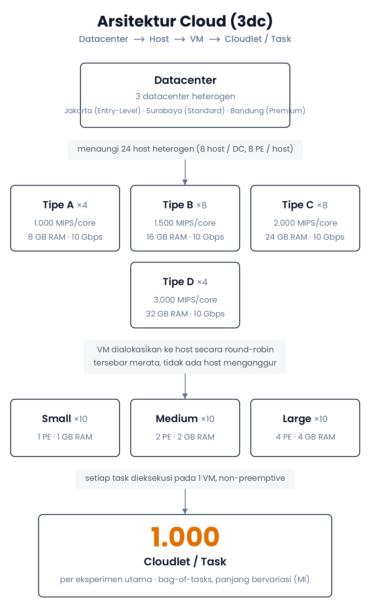 | 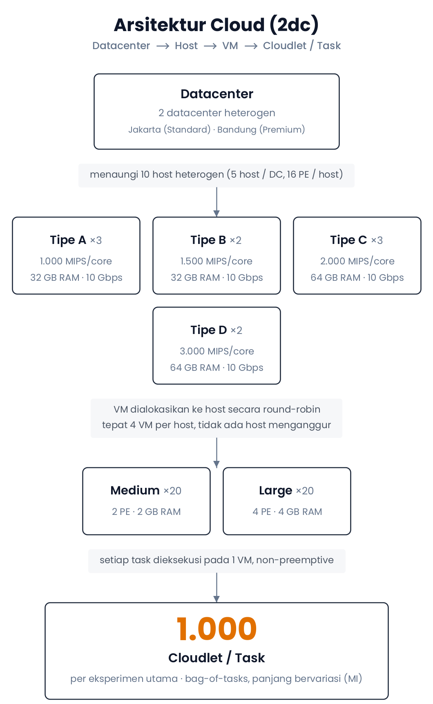 |

Seluruh VM dari semua datacenter disubmit ke **satu broker global**, sehingga broker dapat menempatkan task lintas datacenter. VM ditempatkan ke host dengan kebijakan **round-robin** (`VmAllocationPolicyRoundRobin`) agar tidak ada host yang menganggur, dan task dieksekusi **non-preemptive** (`CloudletSchedulerSpaceShared`).

### 2.1 Skenario `3dc`: 3 Datacenter, 24 Host, 30 VM

| Datacenter | Host | PE/Host | MIPS/core | RAM Host | VM | Spesifikasi VM |
| :--- | :--- | :---: | :---: | :---: | :---: | :--- |
| DC-1: Jakarta (Entry-Level) | 4 × Tipe A, 4 × Tipe B | 8 | 1.000 / 1.500 | 8 / 16 GB | 10 Small | 1 PE, 1.000 MIPS, 1 GB |
| DC-2: Surabaya (Standard) | 4 × Tipe B, 4 × Tipe C | 8 | 1.500 / 2.000 | 16 / 24 GB | 10 Medium | 2 PE, 1.500 MIPS, 2 GB |
| DC-3: Bandung (Premium) | 4 × Tipe C, 4 × Tipe D | 8 | 2.000 / 3.000 | 24 / 32 GB | 10 Large | 4 PE, 2.000 MIPS, 4 GB |
| **Total** | **24 host (352.000 MIPS)** | | | | **30 VM (120.000 MIPS)** | |

### 2.2 Skenario `2dc`: 2 Datacenter, 10 Host, 40 VM

| Datacenter | Host | PE/Host | MIPS/core | RAM Host | VM | Spesifikasi VM |
| :--- | :--- | :---: | :---: | :---: | :---: | :--- |
| DC-1: Jakarta (Standard) | 3 × Tipe A, 2 × Tipe B | 16 | 1.000 / 1.500 | 32 GB | 20 Medium | 2 PE, 1.000 MIPS, 2 GB |
| DC-2: Bandung (Premium) | 3 × Tipe C, 2 × Tipe D | 16 | 2.000 / 3.000 | 64 GB | 20 Large | 4 PE, 2.000 MIPS, 4 GB |
| **Total** | **10 host (288.000 MIPS)** | | | | **40 VM (200.000 MIPS)** | |

Bukti penempatan VM ke host pada skenario `2dc` (output asli `./gradlew testAllocation -Pskenario=2dc`, salinan lengkap di [`results/2dc/logs/testAllocation.txt`](results/2dc/logs/testAllocation.txt)):

```text
  BUKTI VERIFIKASI ALOKASI VM KE HOST FISIK
  +------------------------------+----------+----------------+------------------+----------------------------------------+
  | Datacenter                   | Host     | Kapasitas      | RAM Terpakai     | VM Ditempatkan                         |
  +------------------------------+----------+----------------+------------------+----------------------------------------+
  | DC-1: Jakarta (Standard)     | #1       | 16 PE x 1000   |   8192/ 32768 MB | 4 VM [0, 5, 10, 15]                    |
  | DC-1: Jakarta (Standard)     | #2       | 16 PE x 1000   |   8192/ 32768 MB | 4 VM [1, 6, 11, 16]                    |
  | DC-1: Jakarta (Standard)     | #3       | 16 PE x 1000   |   8192/ 32768 MB | 4 VM [2, 7, 12, 17]                    |
  | DC-1: Jakarta (Standard)     | #4       | 16 PE x 1500   |   8192/ 32768 MB | 4 VM [3, 8, 13, 18]                    |
  | DC-1: Jakarta (Standard)     | #5       | 16 PE x 1500   |   8192/ 32768 MB | 4 VM [4, 9, 14, 19]                    |
  +------------------------------+----------+----------------+------------------+----------------------------------------+
  | DC-2: Bandung (Premium)      | #1       | 16 PE x 2000   |  16384/ 65536 MB | 4 VM [20, 25, 30, 35]                  |
  | DC-2: Bandung (Premium)      | #2       | 16 PE x 2000   |  16384/ 65536 MB | 4 VM [21, 26, 31, 36]                  |
  | DC-2: Bandung (Premium)      | #3       | 16 PE x 2000   |  16384/ 65536 MB | 4 VM [22, 27, 32, 37]                  |
  | DC-2: Bandung (Premium)      | #4       | 16 PE x 3000   |  16384/ 65536 MB | 4 VM [23, 28, 33, 38]                  |
  | DC-2: Bandung (Premium)      | #5       | 16 PE x 3000   |  16384/ 65536 MB | 4 VM [24, 29, 34, 39]                  |
  +------------------------------+----------+----------------+------------------+----------------------------------------+
  Status: 10 dari 10 host aktif, 0 host menganggur. Pola penempatan: 10 host x 4 VM
```

### 2.3 Model Energi SPECpower

Setiap host memakai model daya linier dengan nilai idle/maks dari benchmark SPECpower (Beloglazov & Buyya, 2012). Nilainya sama di kedua skenario:

| Tipe | Referensi Server | P<sub>idle</sub> | P<sub>max</sub> |
| :---: | :--- | :---: | :---: |
| A | HP ProLiant ML110 G5 | 93,7 W | 135,0 W |
| B | IBM System x3250 M2 | 105,0 W | 175,0 W |
| C | IBM System x3550 M3 | 120,0 W | 225,0 W |
| D | Server enterprise kelas atas | 140,0 W | 300,0 W |

$$E_{\text{host}} = P_{\max} \cdot t_{\text{busy}} + P_{\text{idle}} \cdot (\text{Makespan} - t_{\text{busy}}), \qquad E_{\text{total}}\ (\text{kWh}) = \frac{\sum_h E_{\text{host},h}\ (\text{J})}{3.600.000}$$

---

## 3. Algoritma Penjadwalan

### 3.1 PEFT (Predict Earliest Finish Time)
Kode: [`PeftBroker.java`](src/main/java/com/kelompok8/PeftBroker.java)

1. **Urutan task**: menurut waktu kedatangan $a_i$; task yang tiba bersamaan diurutkan dari yang terpanjang (*Longest Processing Time*).
2. **Filter kapasitas**: hanya VM dengan $P_{vm} \ge P_{task}$ yang menjadi kandidat.
3. **Earliest Start Time**: $\text{EST}(i,j) = \max(a_i,\ \text{waktu bebas core ke-}P_{task}\text{ pada VM } j)$
4. **Estimated Execution Time**: $\text{EET}(i,j) = L_i / \text{MIPS}_j$
5. **Earliest Finish Time**: $\text{EFT}(i,j) = \text{EST}(i,j) + \text{EET}(i,j)$
6. **Pemilihan VM**: VM dengan $\text{EFT}$ terkecil; bila seri, dipilih VM ber-MIPS lebih tinggi. Jadwal core VM tersebut lalu diperbarui.

### 3.2 Baseline
- **FCFS** ([`FcfsBroker.java`](src/main/java/com/kelompok8/FcfsBroker.java)): task diurutkan menurut waktu kedatangan, lalu dibagikan bergiliran ke VM yang memenuhi kebutuhan PE.
- **Round Robin** ([`RoundRobinBroker.java`](src/main/java/com/kelompok8/RoundRobinBroker.java)): task dibagikan bergiliran ke VM yang memenuhi kebutuhan PE sesuai urutan masuk, tanpa pengurutan.

Keduanya memakai penunjuk giliran terpisah per kebutuhan PE dan tidak memperhitungkan panjang task maupun kecepatan VM. Akibatnya, bila urutan masuk sudah sama dengan urutan kedatangan (trace NASA) atau semua task tiba bersamaan (GoCJ), **FCFS dan Round Robin menghasilkan penjadwalan yang identik**. Pada dataset sintetis urutan masuknya acak, sehingga hasil keduanya berbeda.

### 3.3 Batasan
- Task berkebutuhan $k$ PE hanya ditempatkan pada VM dengan $P_{vm} \ge k$.
- Non-preemptive: task yang sudah berjalan tidak diinterupsi atau dimigrasikan.
- Setiap task berjalan utuh pada satu VM.

---

## 4. Dataset

Loader dataset ada di [`SwfParser.java`](src/main/java/com/kelompok8/SwfParser.java).

### 4.1 Sintetis Terkontrol (100 – 10.000 task)
Dibangkitkan dengan seed tetap (42) dan disimpan sebagai bukti di `dataset/synthetic_dataset_{N}.csv`. Simulasi utama dan batch membaca berkas CSV yang sama.

| Kelas | Porsi | Panjang | PE | Kedatangan |
| :--- | :---: | :--- | :---: | :--- |
| Kecil | 30% | 500 – 5.000 MI | 1 | uniform 0 – 100 s |
| Sedang | 40% | 5.000 – 50.000 MI | 2 | uniform 0 – 200 s |
| Besar | 30% | 50.000 – 500.000 MI | 4 | uniform 0 – 300 s |

### 4.2 Trace Asli NASA Ames iPSC/860 (100 – 1.000 job)
- **Berkas**: [`dataset/NASA-iPSC-1993-3.1-cln.swf.gz`](dataset/NASA-iPSC-1993-3.1-cln.swf.gz), versi *cleaned* dari [Parallel Workloads Archive](https://www.cs.huji.ac.il/labs/parallel/workload/l_nasa_ipsc/) (Oktober – Desember 1993, 18.239 job, 128 node).
- **SHA-256**: `5589ae9b2fb78e3bf92de097497cf33a91607de1ad54563e43533f7827597f29`
- **Pemetaan ke cloudlet**: *submit time* → waktu kedatangan relatif, *run time* × 1.000 MIPS → panjang (MI), dan jumlah prosesor → 1 / 2 / 4 PE (permintaan > 2 prosesor dibatasi 4 PE, kapasitas VM terbesar). Job dengan *run time* ≤ 0 dilewati.
- **Profil 1.000 job pertama** (dari log):

```text
  PROFIL DATASET: NASA-iPSC (1,000 task)
  ------------------------------------------------------------------------------
    Task 1 PE :    321 ( 32.1%) | 1,000 - 1,965,000 MI
    Task 2 PE :     90 (  9.0%) | 5,000 - 5,226,000 MI
    Task 4 PE :    589 ( 58.9%) | 3,000 - 19,761,000 MI
    Panjang   : min 1,000 MI | maks 19,761,000 MI | rata-rata 624,381.0 MI
    Kedatangan: min 0.00 s | maks 587,055.00 s | rata-rata 340,597.44 s
  ------------------------------------------------------------------------------
```

Kedatangan 1.000 job ini tersebar selama sekitar **6,8 hari** (587.055 s), jauh lebih renggang daripada dataset sintetis.

### 4.3 GoCJ: Google Cloud Jobs (100 – 1.000 job)
- **Berkas**: `dataset/gocj/GoCJ_Dataset_{100..1000}.txt`, berkas resmi Hussain & Aleem (2018) dari Mendeley Data. Isinya diverifikasi identik dengan dua salinan independen di GitHub.
- Setiap baris berisi panjang satu job dalam MI. Untuk 1.000 job: 15.000 – 900.000 MI, median 93.000 MI, rata-rata 129.662 MI.
- GoCJ **tidak memuat** waktu kedatangan maupun kebutuhan prosesor. Karena itu diasumsikan semua job tiba pada **t = 0** (*batch*) dan masing-masing membutuhkan **1 PE**.

---

## 5. Hasil Skenario 3 DC

Grafik dihasilkan oleh `./gradlew generateCharts` dari CSV di [`results/3dc/`](results/3dc). Setiap titik adalah rata-rata 3 run.

### 5.1 Sintetis, 1.000 task
Sumber: [`results/3dc/synthetic_results.csv`](results/3dc/synthetic_results.csv). Nilai terbaik per baris ditebalkan.

| Metrik | PEFT | FCFS | Round Robin | PEFT vs FCFS | PEFT vs RR |
| :--- | ---: | ---: | ---: | ---: | ---: |
| Task selesai | 1.000 | 1.000 | 1.000 | 0,00% | 0,00% |
| Makespan (s) | **4.185,59** | 4.946,72 | 4.574,82 | -15,39% | -8,51% |
| Avg turnaround time (s) | **679,77** | 703,58 | 722,85 | -3,38% | -5,96% |
| Avg waiting time (s) | **631,03** | 655,92 | 675,17 | -3,79% | -6,54% |
| Throughput (task/s) | **0,2389** | 0,2022 | 0,2186 | 18,18% | 9,30% |
| Avg utilisasi CPU VM (%) | **38,74** | 31,96 | 34,58 | 21,21% | 12,03% |
| Load balance (SD task/VM) | **5,32** | 20,55 | 20,55 | -74,12% | -74,12% |
| Energi SPECpower (kWh) | **4,776** | 5,382 | 5,081 | -11,25% | -6,00% |

### 5.2 NASA iPSC/860, 1.000 job
Sumber: [`results/3dc/nasa_ipsc_results.csv`](results/3dc/nasa_ipsc_results.csv)

| Metrik | PEFT | FCFS | Round Robin | PEFT vs FCFS | PEFT vs RR |
| :--- | ---: | ---: | ---: | ---: | ---: |
| Task selesai | 1.000 | 1.000 | 1.000 | 0,00% | 0,00% |
| Makespan (s) | 587.101,10 | 587.101,10 | 587.101,10 | 0,00% | 0,00% |
| Avg turnaround time (s) | **312,32** | 342,74 | 342,74 | -8,88% | -8,88% |
| Avg waiting time (s) | **0,00** | 20,08 | 20,08 | -100,00% | -100,00% |
| Throughput (task/s) | 0,0017 | 0,0017 | 0,0017 | 0,00% | 0,00% |
| Avg utilisasi CPU VM (%) | 1,77 | **1,83** | **1,83** | -3,21% | -3,21% |
| Load balance (SD task/VM) | 115,07 | **28,12** | **28,12** | 309,17% | 309,17% |
| Energi SPECpower (kWh) | **454,869** | 456,523 | 456,523 | -0,36% | -0,36% |

### 5.3 Distribusi beban per datacenter
Sumber: [`results/3dc/datacenter_sync_results.csv`](results/3dc/datacenter_sync_results.csv). Seluruh 1.000 task terverifikasi selesai, tanpa task hilang maupun duplikat.

<details>
<summary>Tabel sinkronisasi per datacenter</summary>

| Dataset | Algoritma | Datacenter | Host | VM | Task | Porsi | Makespan DC (s) | Energi (kWh) |
| :--- | :--- | :--- | ---: | ---: | ---: | ---: | ---: | ---: |
| Synthetic | PEFT | DC-1: Jakarta (Entry-Level) | 8 | 10 | 290 | 29,0% | 103,86 | 0,926 |
| Synthetic | PEFT | DC-2: Surabaya (Standard) | 8 | 10 | 393 | 39,3% | 747,56 | 1,089 |
| Synthetic | PEFT | DC-3: Bandung (Premium) | 8 | 10 | 317 | 31,7% | 4.185,59 | 1,924 |
| Synthetic | FCFS | DC-1: Jakarta (Entry-Level) | 8 | 10 | 100 | 10,0% | 96,44 | 1,093 |
| Synthetic | FCFS | DC-2: Surabaya (Standard) | 8 | 10 | 300 | 30,0% | 419,71 | 1,259 |
| Synthetic | FCFS | DC-3: Bandung (Premium) | 8 | 10 | 600 | 60,0% | 4.946,72 | 2,175 |
| Synthetic | Round Robin | DC-1: Jakarta (Entry-Level) | 8 | 10 | 100 | 10,0% | 102,91 | 1,011 |
| Synthetic | Round Robin | DC-2: Surabaya (Standard) | 8 | 10 | 300 | 30,0% | 471,80 | 1,167 |
| Synthetic | Round Robin | DC-3: Bandung (Premium) | 8 | 10 | 600 | 60,0% | 4.574,82 | 2,060 |
| NASA-iPSC | PEFT | DC-1: Jakarta (Entry-Level) | 8 | 10 | 0 | 0,0% | 0,00 | 129,619 |
| NASA-iPSC | PEFT | DC-2: Surabaya (Standard) | 8 | 10 | 0 | 0,0% | 0,00 | 146,775 |
| NASA-iPSC | PEFT | DC-3: Bandung (Premium) | 8 | 10 | 1000 | 100,0% | 587.101,10 | 173,912 |
| NASA-iPSC | FCFS | DC-1: Jakarta (Entry-Level) | 8 | 10 | 110 | 11,0% | 576.532,10 | 129,645 |
| NASA-iPSC | FCFS | DC-2: Surabaya (Standard) | 8 | 10 | 160 | 16,0% | 582.252,88 | 146,847 |
| NASA-iPSC | FCFS | DC-3: Bandung (Premium) | 8 | 10 | 730 | 73,0% | 587.101,10 | 174,510 |
| NASA-iPSC | Round Robin | DC-1: Jakarta (Entry-Level) | 8 | 10 | 110 | 11,0% | 576.532,10 | 129,645 |
| NASA-iPSC | Round Robin | DC-2: Surabaya (Standard) | 8 | 10 | 160 | 16,0% | 582.252,88 | 146,847 |
| NASA-iPSC | Round Robin | DC-3: Bandung (Premium) | 8 | 10 | 730 | 73,0% | 587.101,10 | 174,510 |

</details>

### 5.4 Skala 100 – 1.000 task (rata-rata 3 run)
Sumber: [`results/3dc/batch_100_1000_results.csv`](results/3dc/batch_100_1000_results.csv)

**Sintetis**

| Task | Makespan (s) PEFT | Makespan (s) FCFS | Makespan (s) RR | Energi (kWh) PEFT | Energi (kWh) FCFS | Energi (kWh) RR | Makespan PEFT vs FCFS |
| ---: | ---: | ---: | ---: | ---: | ---: | ---: | ---: |
| 100 | **621,41** | 712,80 | 679,44 | **0,643** | 0,714 | 0,690 | -12,82% |
| 200 | **989,62** | 1.171,30 | 1.301,87 | **1,070** | 1,209 | 1,309 | -15,51% |
| 300 | **1.373,08** | 1.599,51 | 1.587,51 | **1,538** | 1,716 | 1,702 | -14,16% |
| 400 | **1.774,87** | 2.086,41 | 2.118,34 | **2,008** | 2,243 | 2,273 | -14,93% |
| 500 | **2.174,16** | 2.770,09 | 2.577,80 | **2,458** | 2,908 | 2,771 | -21,51% |
| 600 | **2.575,77** | 2.783,55 | 2.737,33 | **2,918** | 3,063 | 3,040 | -7,46% |
| 700 | **3.052,38** | 3.422,00 | 3.458,69 | **3,469** | 3,758 | 3,790 | -10,80% |
| 800 | **3.450,93** | 3.880,63 | 4.130,03 | **3,942** | 4,279 | 4,482 | -11,07% |
| 900 | **3.731,87** | 4.314,53 | 4.443,47 | **4,249** | 4,689 | 4,816 | -13,50% |
| 1.000 | **4.185,59** | 4.946,72 | 4.574,82 | **4,776** | 5,382 | 5,081 | -15,39% |

**NASA iPSC/860**: makespan ketiga algoritma praktis sama, sehingga yang dibandingkan adalah turnaround dan waiting time.

| Task | Turnaround (s) PEFT | Turnaround (s) FCFS | Turnaround (s) RR | Waiting (s) PEFT | Waiting (s) FCFS | Waiting (s) RR |
| ---: | ---: | ---: | ---: | ---: | ---: | ---: |
| 100 | **254,48** | 270,65 | 270,65 | **0,00** | 11,00 | 11,00 |
| 200 | **330,21** | 345,47 | 345,47 | **0,00** | 5,50 | 5,50 |
| 300 | **336,99** | 348,18 | 348,18 | **0,00** | 3,67 | 3,67 |
| 400 | **295,92** | 310,84 | 310,84 | **0,00** | 6,32 | 6,32 |
| 500 | **309,12** | 335,55 | 335,55 | **0,00** | 15,93 | 15,93 |
| 600 | **321,02** | 353,07 | 353,07 | **0,00** | 21,60 | 21,60 |
| 700 | **335,35** | 370,21 | 370,21 | **0,00** | 24,31 | 24,31 |
| 800 | **311,51** | 343,98 | 343,98 | **0,00** | 22,15 | 22,15 |
| 900 | **324,38** | 358,05 | 358,05 | **0,00** | 22,31 | 22,31 |
| 1.000 | **312,32** | 342,74 | 342,74 | **0,00** | 20,08 | 20,08 |

### 5.5 Skala besar 1.000 – 10.000 task, sintetis (rata-rata 3 run)
Sumber: [`results/3dc/synthetic_1000_10000_results.csv`](results/3dc/synthetic_1000_10000_results.csv)

| Task | Makespan (s) PEFT | Makespan (s) FCFS | Makespan (s) RR | Energi (kWh) PEFT | Energi (kWh) FCFS | Energi (kWh) RR | Makespan PEFT vs FCFS |
| ---: | ---: | ---: | ---: | ---: | ---: | ---: | ---: |
| 1.000 | **4.185,59** | 4.946,72 | 4.574,82 | **4,78** | 5,38 | 5,08 | -15,39% |
| 2.000 | **8.123,59** | 9.189,56 | 9.361,24 | **9,29** | 10,13 | 10,28 | -11,60% |
| 3.000 | **12.567,35** | 13.880,51 | 13.650,70 | **14,39** | 15,47 | 15,30 | -9,46% |
| 4.000 | **16.451,44** | 17.185,63 | 18.855,24 | **18,86** | 19,48 | 20,81 | -4,27% |
| 5.000 | **20.933,74** | 22.563,91 | 22.655,22 | **24,01** | 25,39 | 25,46 | -7,22% |
| 6.000 | **24.743,15** | 27.235,60 | 26.535,14 | **28,39** | 30,43 | 29,91 | -9,15% |
| 7.000 | **29.048,83** | 31.250,87 | 32.056,76 | **33,34** | 35,15 | 35,76 | -7,05% |
| 8.000 | **33.077,39** | 35.462,86 | 35.588,02 | **37,97** | 39,99 | 39,95 | -6,73% |
| 9.000 | **37.408,97** | 40.929,40 | 41.772,18 | **42,94** | 45,88 | 46,44 | -8,60% |
| 10.000 | **41.457,69** | 44.897,66 | 44.444,82 | **47,61** | 50,40 | 50,03 | -7,66% |

### 5.6 GoCJ 100 – 1.000 job (rata-rata 3 run)
Sumber: [`results/3dc/gocj_100_1000_results.csv`](results/3dc/gocj_100_1000_results.csv)

| Task | Makespan (s) PEFT | Makespan (s) FCFS | Makespan (s) RR | Energi (kWh) PEFT | Energi (kWh) FCFS | Energi (kWh) RR | Makespan PEFT vs FCFS |
| ---: | ---: | ---: | ---: | ---: | ---: | ---: | ---: |
| 100 | **450,21** | 826,81 | 826,81 | **0,407** | 0,720 | 0,720 | -45,55% |
| 200 | **450,21** | 2.785,92 | 2.785,92 | **0,479** | 2,306 | 2,306 | -83,84% |
| 300 | **450,21** | 2.077,63 | 2.077,63 | **0,539** | 1,849 | 1,849 | -78,33% |
| 400 | **450,21** | 2.183,07 | 2.183,07 | **0,581** | 2,002 | 2,002 | -79,38% |
| 500 | **548,74** | 3.041,11 | 3.041,11 | **0,717** | 2,732 | 2,732 | -81,96% |
| 600 | **695,47** | 4.778,93 | 4.778,93 | **0,908** | 4,170 | 4,170 | -85,45% |
| 700 | **741,13** | 4.777,02 | 4.777,02 | **0,966** | 4,229 | 4,229 | -84,49% |
| 800 | **834,42** | 4.205,77 | 4.205,77 | **1,089** | 3,845 | 3,845 | -80,16% |
| 900 | **1.009,04** | 4.857,14 | 4.857,14 | **1,319** | 4,479 | 4,479 | -79,23% |
| 1.000 | **1.091,83** | 5.707,22 | 5.707,22 | **1,426** | 5,203 | 5,203 | -80,87% |

### 5.7 Grafik
| | |
| :---: | :---: |
| 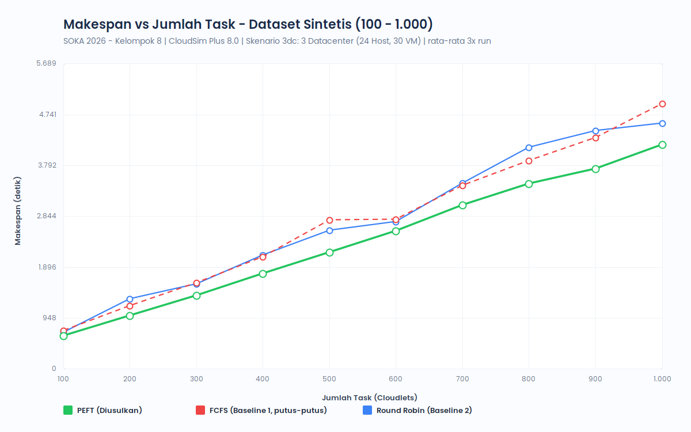 | 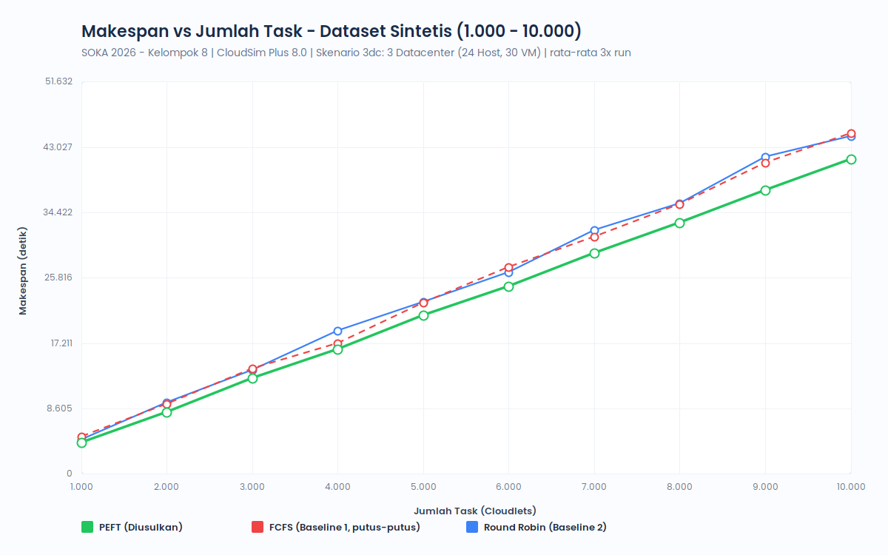 |
| 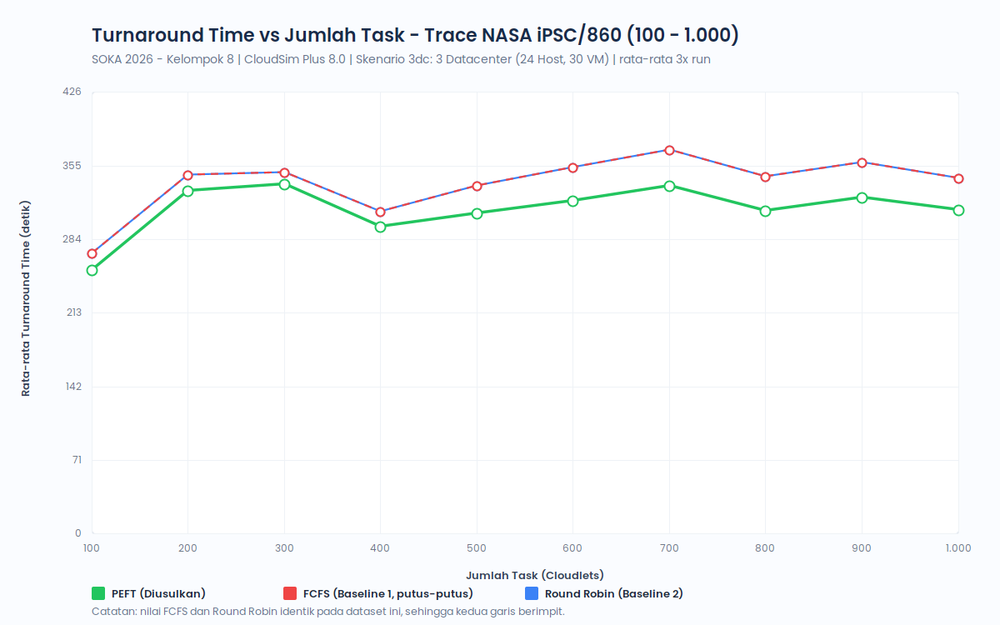 | 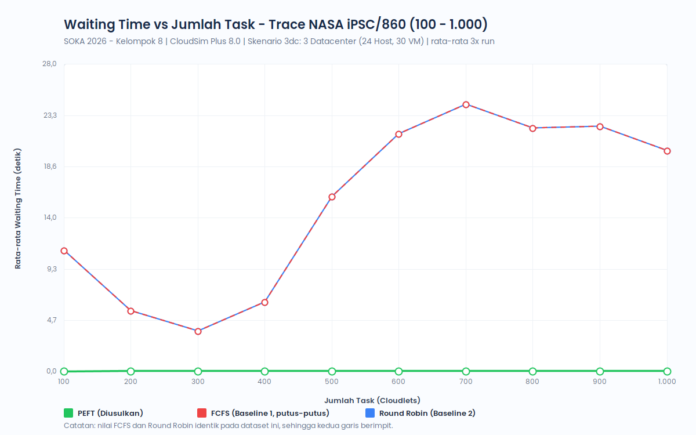 |
| 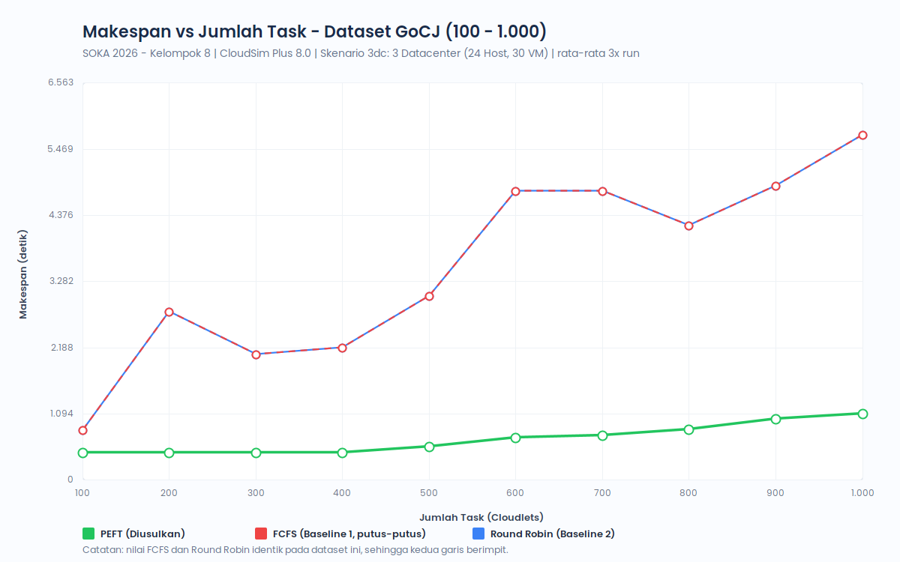 |  |
| 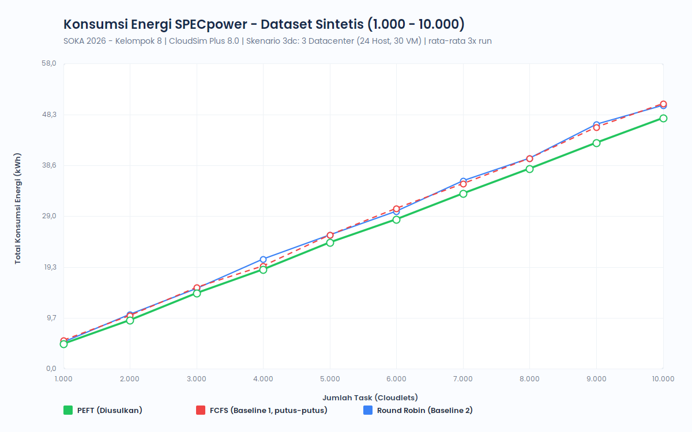 | 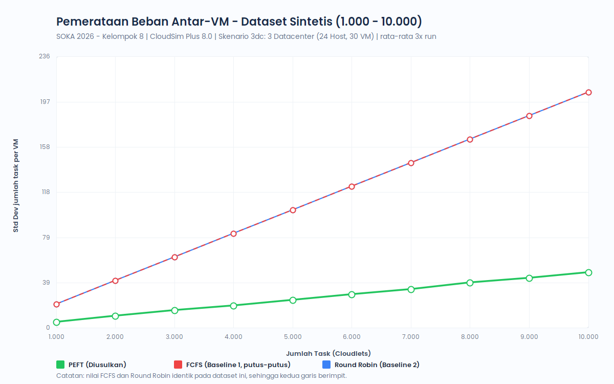 |

---

## 6. Hasil Skenario 2 DC

Sumber: CSV di [`results/2dc/`](results/2dc), dihasilkan dengan `-Pskenario=2dc`.

### 6.1 Sintetis, 1.000 task

| Metrik | PEFT | FCFS | Round Robin | PEFT vs FCFS | PEFT vs RR |
| :--- | ---: | ---: | ---: | ---: | ---: |
| Task selesai | 1.000 | 1.000 | 1.000 | 0,00% | 0,00% |
| Makespan (s) | **2.172,86** | 3.094,28 | 2.476,28 | -29,78% | -12,25% |
| Avg turnaround time (s) | **360,84** | 370,70 | 375,91 | -2,66% | -4,01% |
| Avg waiting time (s) | **308,85** | 321,14 | 326,34 | -3,83% | -5,36% |
| Throughput (task/s) | **0,4602** | 0,3232 | 0,4038 | 42,41% | 13,96% |
| Avg utilisasi CPU VM (%) | **59,70** | 39,91 | 49,85 | 49,59% | 19,77% |
| Load balance (SD task/VM) | 9,86 | **7,00** | **7,00** | 40,84% | 40,84% |
| Energi SPECpower (kWh) | **1,225** | 1,529 | 1,335 | -19,88% | -8,24% |

### 6.2 NASA iPSC/860, 1.000 job

| Metrik | PEFT | FCFS | Round Robin | PEFT vs FCFS | PEFT vs RR |
| :--- | ---: | ---: | ---: | ---: | ---: |
| Task selesai | 1.000 | 1.000 | 1.000 | 0,00% | 0,00% |
| Makespan (s) | 587.101,10 | 587.101,10 | 587.101,10 | 0,00% | 0,00% |
| Avg turnaround time (s) | **312,32** | 332,09 | 332,09 | -5,95% | -5,95% |
| Avg waiting time (s) | **0,00** | 7,09 | 7,09 | -100,00% | -100,00% |
| Throughput (task/s) | 0,0017 | 0,0017 | 0,0017 | 0,00% | 0,00% |
| Avg utilisasi CPU VM (%) | 1,33 | **1,38** | **1,38** | -3,90% | -3,90% |
| Load balance (SD task/VM) | 100,70 | **14,46** | **14,46** | 596,37% | 596,37% |
| Energi SPECpower (kWh) | **187,515** | 188,291 | 188,291 | -0,41% | -0,41% |

### 6.3 Distribusi beban per datacenter

<details>
<summary>Tabel sinkronisasi per datacenter</summary>

| Dataset | Algoritma | Datacenter | Host | VM | Task | Porsi | Makespan DC (s) | Energi (kWh) |
| :--- | :--- | :--- | ---: | ---: | ---: | ---: | ---: | ---: |
| Synthetic | PEFT | DC-1: Jakarta (Standard) | 5 | 20 | 650 | 65,0% | 572,85 | 0,316 |
| Synthetic | PEFT | DC-2: Bandung (Premium) | 5 | 20 | 350 | 35,0% | 2.172,86 | 0,745 |
| Synthetic | FCFS | DC-1: Jakarta (Standard) | 5 | 20 | 360 | 36,0% | 359,72 | 0,433 |
| Synthetic | FCFS | DC-2: Bandung (Premium) | 5 | 20 | 640 | 64,0% | 3.094,28 | 0,918 |
| Synthetic | Round Robin | DC-1: Jakarta (Standard) | 5 | 20 | 360 | 36,0% | 431,58 | 0,349 |
| Synthetic | Round Robin | DC-2: Bandung (Premium) | 5 | 20 | 640 | 64,0% | 2.476,28 | 0,808 |
| NASA-iPSC | PEFT | DC-1: Jakarta (Standard) | 5 | 20 | 0 | 0,0% | 0,00 | 80,090 |
| NASA-iPSC | PEFT | DC-2: Bandung (Premium) | 5 | 20 | 1000 | 100,0% | 587.101,10 | 106,560 |
| NASA-iPSC | FCFS | DC-1: Jakarta (Standard) | 5 | 20 | 211 | 21,1% | 583.518,10 | 80,133 |
| NASA-iPSC | FCFS | DC-2: Bandung (Premium) | 5 | 20 | 789 | 78,9% | 587.101,10 | 106,973 |
| NASA-iPSC | Round Robin | DC-1: Jakarta (Standard) | 5 | 20 | 211 | 21,1% | 583.518,10 | 80,133 |
| NASA-iPSC | Round Robin | DC-2: Bandung (Premium) | 5 | 20 | 789 | 78,9% | 587.101,10 | 106,973 |

</details>

### 6.4 Skala 100 – 1.000 task (rata-rata 3 run)

**Sintetis**

| Task | Makespan (s) PEFT | Makespan (s) FCFS | Makespan (s) RR | Energi (kWh) PEFT | Energi (kWh) FCFS | Energi (kWh) RR | Makespan PEFT vs FCFS |
| ---: | ---: | ---: | ---: | ---: | ---: | ---: | ---: |
| 100 | **480,90** | 511,68 | 541,51 | **0,208** | 0,221 | 0,232 | -6,02% |
| 200 | **616,86** | 712,58 | 788,90 | **0,305** | 0,333 | 0,358 | -13,43% |
| 300 | **801,55** | 937,03 | 1.051,08 | **0,426** | 0,467 | 0,503 | -14,46% |
| 400 | **987,66** | 1.250,61 | 1.201,80 | **0,543** | 0,624 | 0,609 | -21,03% |
| 500 | **1.183,63** | 1.656,16 | 1.394,64 | **0,658** | 0,801 | 0,719 | -28,53% |
| 600 | **1.372,77** | 1.561,16 | 1.589,70 | **0,771** | 0,824 | 0,834 | -12,07% |
| 700 | **1.623,50** | 1.827,76 | 1.939,27 | **0,915** | 0,974 | 1,011 | -11,18% |
| 800 | **1.795,17** | 1.964,30 | 2.112,46 | **1,012** | 1,082 | 1,133 | -8,61% |
| 900 | **1.967,69** | 2.532,84 | 2.371,04 | **1,110** | 1,292 | 1,244 | -22,31% |
| 1.000 | **2.172,86** | 3.094,28 | 2.476,28 | **1,225** | 1,529 | 1,335 | -29,78% |

**NASA iPSC/860**

| Task | Turnaround (s) PEFT | Turnaround (s) FCFS | Turnaround (s) RR | Waiting (s) PEFT | Waiting (s) FCFS | Waiting (s) RR |
| ---: | ---: | ---: | ---: | ---: | ---: | ---: |
| 100 | **254,48** | 260,27 | 260,27 | 0,00 | 0,00 | 0,00 |
| 200 | **330,21** | 334,36 | 334,36 | 0,00 | 0,00 | 0,00 |
| 300 | **336,99** | 340,78 | 340,78 | 0,00 | 0,00 | 0,00 |
| 400 | **295,92** | 301,19 | 301,19 | **0,00** | 0,11 | 0,11 |
| 500 | **309,12** | 327,61 | 327,61 | **0,00** | 10,96 | 10,96 |
| 600 | **321,02** | 346,15 | 346,15 | **0,00** | 10,51 | 10,51 |
| 700 | **335,35** | 357,38 | 357,38 | **0,00** | 9,29 | 9,29 |
| 800 | **311,51** | 334,41 | 334,41 | **0,00** | 8,86 | 8,86 |
| 900 | **324,38** | 346,24 | 346,24 | **0,00** | 7,88 | 7,88 |
| 1.000 | **312,32** | 332,09 | 332,09 | **0,00** | 7,09 | 7,09 |

### 6.5 Skala besar 1.000 – 10.000 task, sintetis (rata-rata 3 run)

| Task | Makespan (s) PEFT | Makespan (s) FCFS | Makespan (s) RR | Energi (kWh) PEFT | Energi (kWh) FCFS | Energi (kWh) RR | Makespan PEFT vs FCFS |
| ---: | ---: | ---: | ---: | ---: | ---: | ---: | ---: |
| 1.000 | **2.172,86** | 3.094,28 | 2.476,28 | **1,23** | 1,53 | 1,34 | -29,78% |
| 2.000 | **4.142,86** | 4.917,34 | 4.732,71 | **2,34** | 2,65 | 2,58 | -15,75% |
| 3.000 | **6.382,55** | 7.538,12 | 7.291,61 | **3,60** | 4,08 | 4,00 | -15,33% |
| 4.000 | **8.322,98** | 9.212,38 | 9.807,11 | **4,69** | 5,14 | 5,32 | -9,65% |
| 5.000 | **10.556,84** | 11.858,51 | 11.813,30 | **5,95** | 6,59 | 6,57 | -10,98% |
| 6.000 | **12.436,10** | 14.382,22 | 13.450,29 | **7,01** | 7,90 | 7,58 | -13,53% |
| 7.000 | **14.590,49** | 16.412,61 | 16.364,26 | **8,23** | 9,14 | 9,13 | -11,10% |
| 8.000 | **16.627,44** | 18.314,92 | 18.887,81 | **9,38** | 10,29 | 10,49 | -9,21% |
| 9.000 | **18.793,19** | 20.908,85 | 21.099,67 | **10,60** | 11,69 | 11,75 | -10,12% |
| 10.000 | **20.827,21** | 23.185,11 | 22.714,22 | **11,74** | 12,96 | 12,79 | -10,17% |

### 6.6 GoCJ 100 – 1.000 job (rata-rata 3 run)

| Task | Makespan (s) PEFT | Makespan (s) FCFS | Makespan (s) RR | Energi (kWh) PEFT | Energi (kWh) FCFS | Energi (kWh) RR | Makespan PEFT vs FCFS |
| ---: | ---: | ---: | ---: | ---: | ---: | ---: | ---: |
| 100 | **450,21** | 900,28 | 900,28 | **0,162** | 0,316 | 0,316 | -49,99% |
| 200 | **450,21** | 1.019,49 | 1.019,49 | **0,188** | 0,383 | 0,383 | -55,84% |
| 300 | **450,21** | 1.101,98 | 1.101,98 | **0,216** | 0,441 | 0,441 | -59,15% |
| 400 | **450,21** | 1.627,98 | 1.627,98 | **0,236** | 0,635 | 0,635 | -72,35% |
| 500 | **450,21** | 1.478,46 | 1.478,46 | **0,254** | 0,621 | 0,621 | -69,55% |
| 600 | **450,21** | 1.546,95 | 1.546,95 | **0,254** | 0,675 | 0,675 | -70,90% |
| 700 | **450,21** | 2.348,07 | 2.348,07 | **0,254** | 0,943 | 0,943 | -80,83% |
| 800 | **505,81** | 1.913,33 | 1.913,33 | **0,285** | 0,837 | 0,837 | -73,56% |
| 900 | **610,01** | 2.524,70 | 2.524,70 | **0,344** | 1,077 | 1,077 | -75,84% |
| 1.000 | **661,39** | 3.180,74 | 3.180,74 | **0,373** | 1,299 | 1,299 | -79,21% |

### 6.7 Grafik
| | |
| :---: | :---: |
| 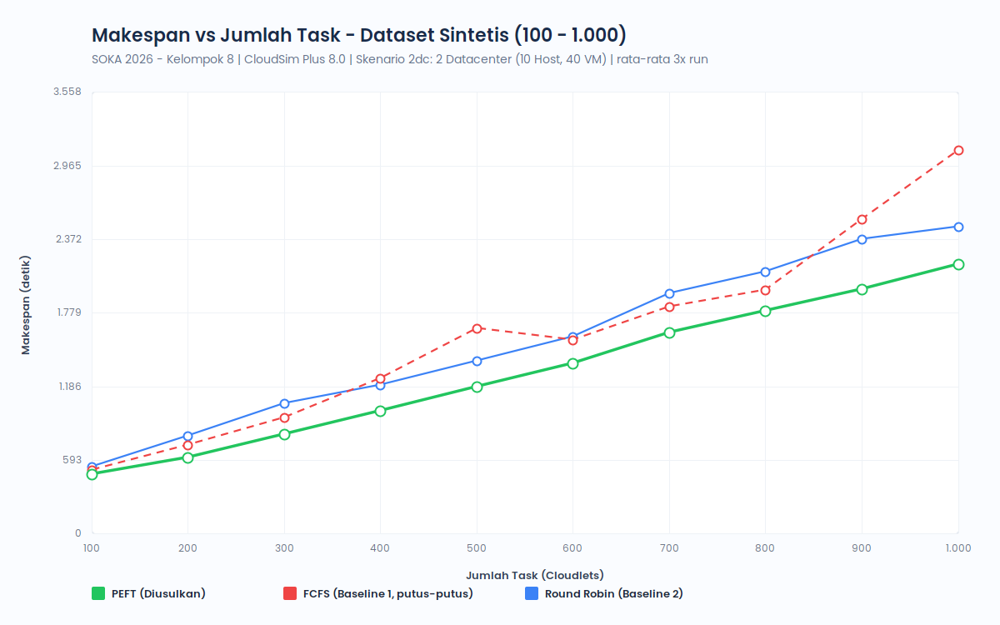 |  |
| 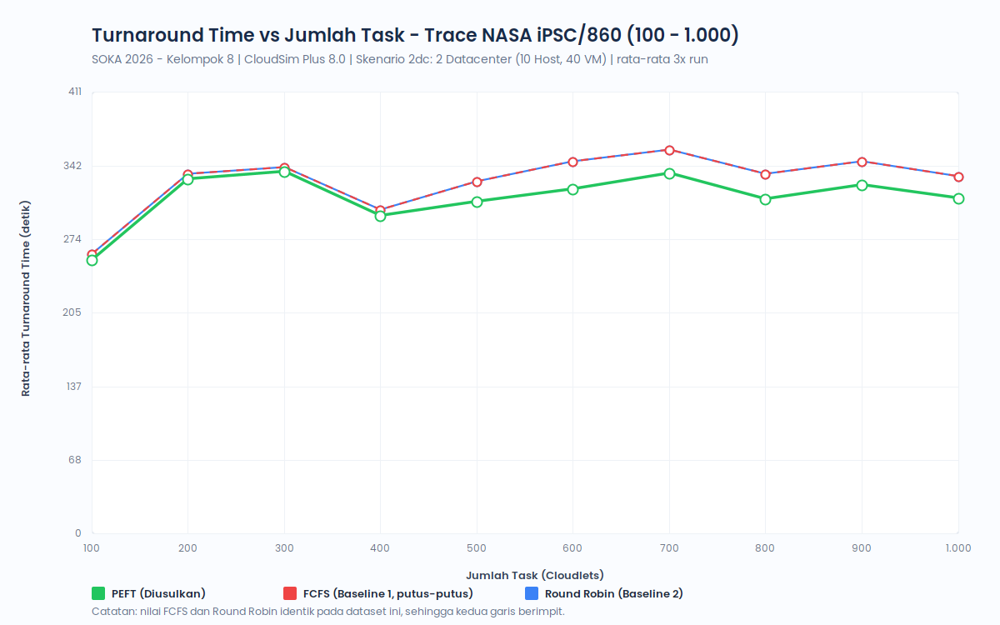 | 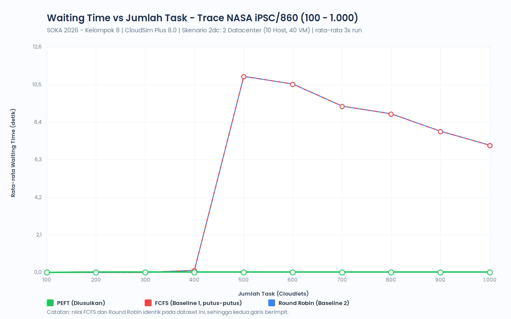 |
| 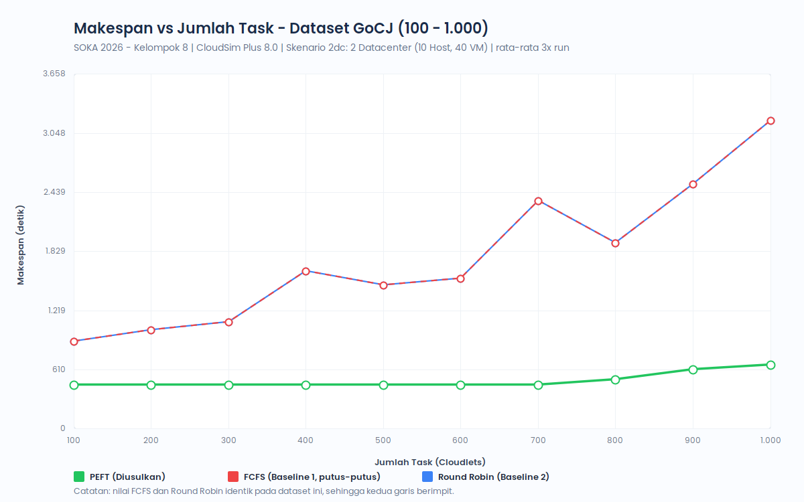 | 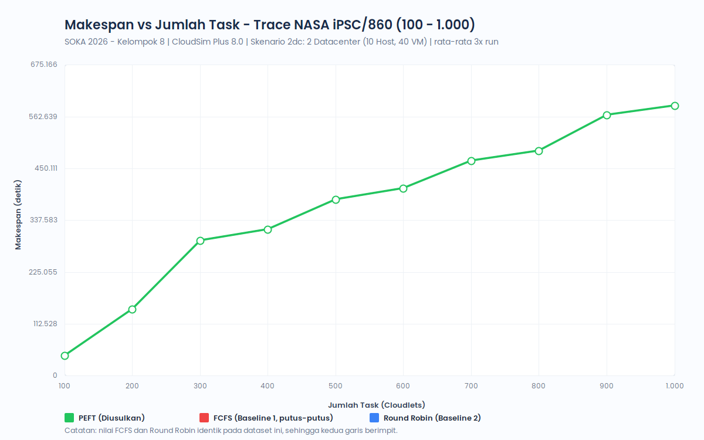 |
| 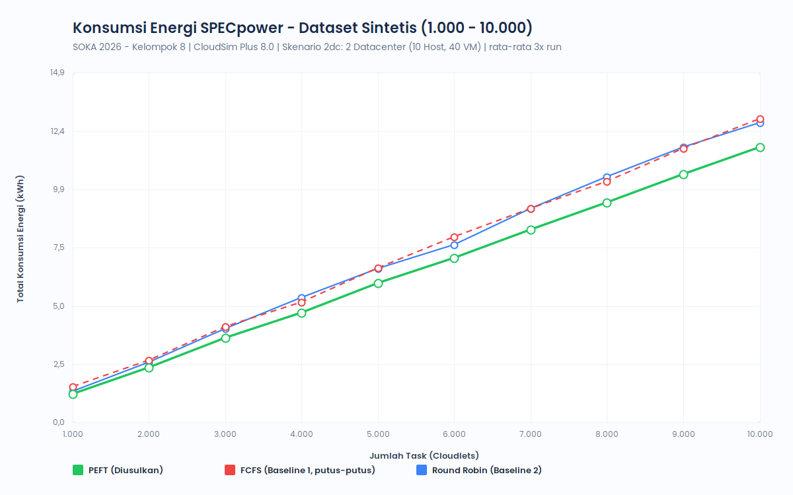 | 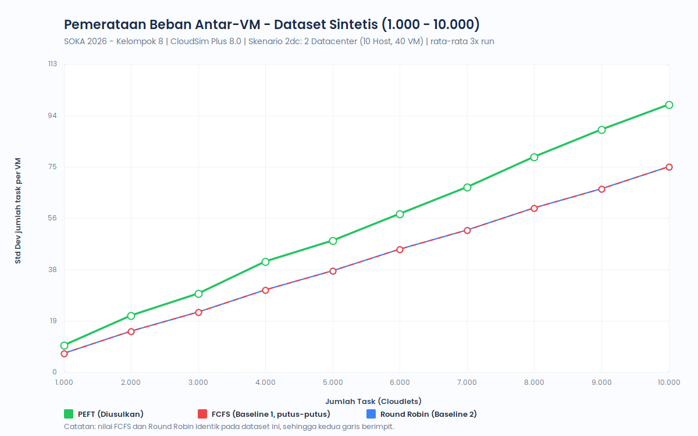 |

---

## 7. Analisis dan Kesimpulan

### 7.1 Mengapa perilaku tiap dataset berbeda?
- **Sintetis: kedatangan padat (0 – 300 s), jadi beban terbatas komputasi.** Antrean menumpuk di seluruh VM, dan di sinilah prediksi EFT berpengaruh. PEFT mengirim task besar ke VM yang paling cepat selesai, sedangkan FCFS/RR membagi rata tanpa melihat kecepatan VM. Keunggulan makespan PEFT 7 – 22% (`3dc`) dan 6 – 30% (`2dc`) pada 100 – 1.000 task, lalu mengecil ke kisaran 4 – 16% pada 2.000 – 10.000 task karena semua VM jenuh.
- **NASA iPSC/860: kedatangan renggang (6,8 hari), jadi beban terbatas waktu kedatangan.** Makespan ditentukan oleh job terakhir yang tiba pada detik ke-587.055, sehingga ketiga algoritma berakhir hampir bersamaan. VM hampir selalu menganggur (utilisasi CPU < 2%), sehingga energi didominasi daya idle dan selisihnya hanya 0,36 – 0,41%. Keunggulan PEFT terlihat pada kualitas layanan: waiting time selalu 0 dan turnaround time 1,1 – 9,4% lebih pendek di seluruh skala 100 – 1.000 job, karena setiap job langsung dikirim ke VM 2.000 MIPS yang sedang bebas.
- **GoCJ: semua job tiba bersamaan dengan variasi panjang besar (15.000 – 900.000 MI).** FCFS/RR menaruh job besar di VM lambat dan membuat antrean panjang, sementara PEFT memilih VM yang selesai paling awal. Pada 100 – 400 job (`3dc`) dan 100 – 700 job (`2dc`), makespan PEFT tertahan di **450,21 s**: itu adalah durasi job terbesar (900.000 MI ÷ 2.000 MIPS), batas bawah yang tidak bisa dilampaui algoritma apa pun pada VM ini.

### 7.2 Perbandingan skenario `3dc` vs `2dc`
- Pada sintetis 1.000 task, makespan PEFT turun dari **4.185,59 s** (`3dc`) menjadi **2.172,86 s** (`2dc`), dan energinya dari **4,776 kWh** menjadi **1,225 kWh**. Penyebabnya: kapasitas VM `2dc` lebih besar (200.000 vs 120.000 MIPS; 20 VM Large vs 10), sementara host fisiknya lebih sedikit (10 vs 24), sehingga daya idle yang terbuang jauh berkurang.
- Pada NASA, hasil PEFT (makespan, turnaround, waiting) **identik** di kedua skenario karena PEFT selalu memakai VM Large 2.000 MIPS, yang spesifikasinya sama di kedua skenario. Yang berbeda hanya energinya (454,9 vs 187,5 kWh), karena jumlah host yang menyala berbeda.

### 7.3 Catatan tentang load balance
Metrik load balance di sini adalah simpangan baku **jumlah task per VM**. PEFT tidak berusaha meratakan jumlah task. PEFT sengaja menumpuk task di VM yang paling cepat menyelesaikannya, sehingga simpangan bakunya bisa lebih tinggi daripada FCFS/RR: NASA (115,07 vs 28,12 pada `3dc`), GoCJ, dan sintetis `2dc` (9,86 vs 7,00). Pada sintetis `3dc` justru sebaliknya (5,32 vs 20,55), karena FCFS/RR memusatkan semua task 4 PE di 10 VM Large. Jadi angka ini menggambarkan pola distribusi task, bukan efisiensi.

### 7.4 Kesimpulan
1. Dari 78 konfigurasi batch (2 skenario × sintetis, NASA, dan GoCJ pada tiap skala), PEFT menghasilkan makespan terpendek atau setara pada 76 konfigurasi. Dua sisanya adalah NASA 800 job, di mana PEFT lebih lama 0,11 s (0,00002%) karena makespan ditentukan oleh job terakhir. Selisih terbesar ada pada beban padat (sintetis dan GoCJ).
2. Pada trace nyata yang renggang (NASA), keunggulan PEFT ada pada kualitas layanan (waiting time 0, turnaround lebih pendek), bukan pada makespan maupun energi.
3. Penghematan energi PEFT berasal dari makespan yang lebih pendek: host lebih cepat kembali ke kondisi selesai, sehingga waktu idle berkurang.
4. Seluruh hasil reproducible: 3 run per konfigurasi menghasilkan nilai identik (simpangan baku antar-run 0).

---

## 8. Menjalankan Simulasi

Prasyarat: **JDK 21**. Dependensi CloudSim Plus diunduh otomatis oleh Gradle Wrapper.

```bash
git clone https://github.com/aryarefman/soka-peft-heuristik.git
cd soka-peft-heuristik
```

Semua task menerima `-Pskenario=3dc` (default) atau `-Pskenario=2dc`. Di Windows gunakan `.\gradlew.bat`.

| Perintah | Fungsi |
| :--- | :--- |
| `./gradlew runAll` | PEFT, FCFS, RR pada sintetis & NASA (1.000 task) → `results/3dc/` |
| `./gradlew runAll -Pskenario=2dc` | Sama, untuk skenario 2 DC → `results/2dc/` |
| `./gradlew runPEFT` / `runFCFS` / `runRoundRobin` | Satu algoritma saja |
| `./gradlew testAllocation -Pskenario=2dc` | Tabel bukti penempatan VM ke host |
| `./gradlew runBatch` | Batch 100 – 1.000, 1.000 – 10.000, dan GoCJ (3× run) |
| `./gradlew generateCharts` | Grafik dari CSV batch → `docs/images/{skenario}/` |
| `./gradlew renderArsitektur` | Diagram arsitektur dari `Skenario.java` |

Urutan untuk mereproduksi seluruh isi README:

```bash
for s in 3dc 2dc; do
  ./gradlew runAll testAllocation runBatch generateCharts renderArsitektur -Pskenario=$s
done
```

Berkas keluaran per skenario (`results/{skenario}/`):

| Berkas | Isi |
| :--- | :--- |
| `synthetic_results.csv`, `nasa_ipsc_results.csv`, `all_results.csv` | Metrik 1.000 task dari `runAll` |
| `datacenter_sync_results.csv` | Distribusi task & energi per datacenter |
| `batch_100_1000_results.csv` | Sintetis & NASA 100 – 1.000 task |
| `synthetic_1000_10000_results.csv` | Sintetis 1.000 – 10.000 task |
| `gocj_100_1000_results.csv` | GoCJ 100 – 1.000 job |
| `logs/*.txt` | Output terminal asli tiap perintah |

---

## 9. Struktur Repository

```
soka-peft-heuristik/
├── build.gradle                     # Dependensi CloudSim Plus 8.0.0 & task Gradle (runAll, runBatch, ...)
├── Assets/                          # Logo ITS
├── dataset/
│   ├── NASA-iPSC-1993-3.1-cln.swf.gz  # Trace asli NASA iPSC/860 (Parallel Workloads Archive)
│   ├── gocj/                        # GoCJ_Dataset_100..1000.txt (Hussain & Aleem, 2018)
│   └── synthetic_dataset_*.csv      # Dataset sintetis seed 42 (100 – 10.000 task)
├── docs/
│   ├── images/3dc/, images/2dc/     # Grafik & diagram arsitektur per skenario
│   ├── PANDUAN_SKENARIO_2DC.md      # Panduan demo skenario 2 DC
│   ├── CATATAN_REVISI_BU_HENNING_DAN_MITIGASI.md
│   ├── Tugas_3_Kelompok_8_Proposal.docx / .pdf
│   └── Laporan_Hasil_Uji_Coba_Kelompok_8.docx / .pdf
├── fonts/                           # Poppins (grafik & diagram)
├── results/3dc/, results/2dc/       # CSV hasil + logs/ output terminal
├── tools/TransformDocxToPoppins.java  # Utilitas mengganti font dokumen .docx ke Poppins
└── src/main/java/com/kelompok8/
    ├── Skenario.java                # Definisi skenario 3dc & 2dc
    ├── DatacenterBuilder.java       # Membangun DC, host, VM dari Skenario
    ├── PeftBroker.java              # Algoritma PEFT
    ├── FcfsBroker.java              # Baseline FCFS
    ├── RoundRobinBroker.java        # Baseline Round Robin
    ├── SwfParser.java               # Loader NASA SWF, GoCJ, dan generator sintetis
    ├── MetricsCollector.java        # Makespan, turnaround, waiting, utilisasi, energi SPECpower
    ├── DatacenterSynchronizer.java  # Verifikasi & rekap per datacenter
    ├── MainSimulation.java          # Eksperimen utama 1.000 task
    ├── BatchExperimentSuite.java    # Eksperimen berskala, 3× run
    ├── GenerateEvaluationCharts.java  # Grafik PNG
    ├── RenderArsitektur.java        # Diagram arsitektur PNG
    └── TestVmHostAllocation.java    # Bukti penempatan VM ke host
```

> **Catatan dokumen Word/PDF di `docs/`:** proposal dan *Laporan Hasil Uji Coba* adalah versi yang dikumpulkan sebelumnya dan masih memuat angka dari dataset NASA lama (trace hasil generator, bukan trace asli). Angka terbaru yang valid adalah yang ada di README ini dan di `results/`.

---

## 10. Referensi

1. Arabnejad H, Barbosa JG. List Scheduling Algorithm for Heterogeneous Systems by an Optimistic Cost Table. *IEEE Transactions on Parallel and Distributed Systems*. 2014;25(3):682–694.
2. Beloglazov A, Buyya R. Optimal online deterministic algorithms and adaptive heuristics for energy and performance efficient dynamic consolidation of virtual machines in cloud data centers. *Concurrency and Computation: Practice and Experience*. 2012;24(13):1397–1420.
3. Silva Filho MC, Oliveira RL, Monteiro CC, Inácio PRM, Freire MM. CloudSim Plus: A cloud computing simulation framework pursuing software engineering principles for improved modularity, extensibility and correctness. *IFIP/IEEE International Symposium on Integrated Network Management (IM)*. 2017.
4. Feitelson DG, Tsafrir D, Krakov D. Experience with using the Parallel Workloads Archive. *Journal of Parallel and Distributed Computing*. 2014;74(10):2967–2982. Trace: https://www.cs.huji.ac.il/labs/parallel/workload/l_nasa_ipsc/
5. Hussain A, Aleem M. GoCJ: Google Cloud Jobs Dataset for Distributed and Cloud Computing Infrastructures. *Data*. 2018;3(4):38.
6. Arunarani AR, Manjula D, Sugumaran V. Task scheduling techniques in cloud computing: A literature survey. *Future Generation Computer Systems*. 2019;91:407–415.

---
<p align="center">
  <b>Kelompok 8 · Strategi Optimasi Komputasi Awan (SOKA)</b><br>
  Departemen Teknologi Informasi, Institut Teknologi Sepuluh Nopember · Surabaya, 2026
</p>
