<p align="center">
  
</p>

<h1 align="center">Implementasi Real-World PEFT di Kubernetes</h1>
<h3 align="center">Strategi Optimasi Komputasi Awan (SOKA) 2026 · Kelompok 8</h3>
<p align="center">Departemen Teknologi Informasi · Institut Teknologi Sepuluh Nopember (ITS)</p>

<p align="center">
  
  
  
  
  
  
</p>

---

## Anggota Kelompok 8

| No. | Nama | NRP | Fokus |
| :---: | :--- | :---: | :--- |
| 1 | Arya Bisma Putra Refman | 5027241036 | Arsitektur datacenter & simulation runner |
| 2 | Muhammad Ziddan Habibi | 5027241122 | Formulasi & algoritma PEFT |
| 3 | Prabaswara Febrian Winandika | 5027241069 | Algoritma baseline (FCFS & Round Robin) |
| 4 | Muhammad Fachry Shalahuddin Rusamsi | 5027241031 | Preprocessing dataset (SWF, GoCJ, sintetis) |
| 5 | Gemilang Ananda | 5027241072 | Metrik evaluasi & model energi SPECpower |

---

## Daftar Isi

1. [Ringkasan](#1-ringkasan)
2. [Pemetaan ke Syarat Tugas](#2-pemetaan-ke-syarat-tugas)
3. [Arsitektur Real-World](#3-arsitektur-real-world)
4. [Alur Eksekusi dan Algoritma](#4-alur-eksekusi-dan-algoritma)
5. [Dataset](#5-dataset)
6. [Hasil Eksekusi Real-World](#6-hasil-eksekusi-real-world)
7. [Cara Membandingkan Simulasi dengan Dunia Nyata](#7-cara-membandingkan-simulasi-dengan-dunia-nyata)
8. [Grafik dan Analisis Simulasi vs Real-World](#8-grafik-dan-analisis-simulasi-vs-real-world)
9. [Gangguan Eksternal: Beban Lain, Mode Daya, dan Memori Laptop](#9-gangguan-eksternal-beban-lain-mode-daya-dan-memori-laptop)
10. [Kaitan dengan Simulasi CloudSim Skala Besar](#10-kaitan-dengan-simulasi-cloudsim-skala-besar)
11. [Kesimpulan](#11-kesimpulan)
12. [Keterbatasan](#12-keterbatasan)
13. [Menjalankan Eksperimen](#13-menjalankan-eksperimen)
14. [Struktur Folder](#14-struktur-folder)
15. [Referensi](#15-referensi)

---

## 1. Ringkasan

Di folder induk, algoritma **PEFT** diuji di **simulator** (CloudSim Plus). Simulator hanya *menghitung* berapa lama task akan selesai. Di folder ini, PEFT dijalankan di **cloud nyata** buatan sendiri: sebuah cluster **Kubernetes** berisi 1 datacenter, 2 host, dan 4 VM. Task dieksekusi secara nyata oleh CPU, dan waktunya diukur sebagai waktu jam dinding (*wall-clock time*), bukan dihitung oleh model.

PEFT dibandingkan dengan dua algoritma sederhana, **FCFS** dan **Round Robin (RR)**, pada dua jenis beban kerja: **GoCJ** (data job asli Google Cloud) dan **sintetis** (task buatan dengan kebutuhan 1, 2, atau 4 core).

**Pertanyaan utama:** *apakah hasil di dunia nyata sama dengan hasil simulasi? Jika berbeda, apa sebabnya?*

Untuk menjawabnya secara adil, setiap percobaan nyata dibuatkan **kembaran simulasinya**: task yang sama, waktu datang yang sama, dan VM tujuan yang sama persis. Bedanya hanya satu: kembaran simulasi berjalan di "kondisi ideal" (VM selalu secepat spesifikasinya dan tidak ada jeda jaringan). Dengan demikian, jika hasilnya berbeda, penyebabnya pasti dari dunia nyata, bukan dari keputusan algoritma.

Percobaan dilakukan dalam **dua tahap**:
1. **Percobaan pertama**: 30 task per dataset, dijalankan 1 kali. Dianalisis sangat detail sampai ke setiap task (Bagian 6.1 – 6.3 dan 8.1 – 8.9).
2. **Eksperimen berskala**: 10, 20, 30, 40, dan 50 task, masing-masing dijalankan **3 kali**, total **27 run bersih** (Bagian 6.4 dan 8.10 – 8.16). Setiap run dijaga oleh **pemeriksaan kecepatan**: run yang terganggu program lain di laptop otomatis dibuang dan diulang (Bagian 9).

**Temuan utama:**
- **Di GoCJ, PEFT unggul jauh di dunia nyata, di semua skala.** Makespan PEFT **7 – 77%** lebih cepat daripada FCFS (misalnya 15,91 detik vs 38,55 detik pada 50 task), dan waktu antrenya **37 – 97%** lebih singkat.
- **Di data sintetis, keunggulan makespan PEFT hilang di dunia nyata.** Simulasi memprediksi PEFT 8 – 12% lebih cepat pada 30 – 40 task, tetapi kenyataannya PEFT justru 2 – 3% *lebih lambat*. PEFT hanya masih unggul di waktu antre (13 – 16% lebih singkat pada 30 – 40 task).
- **Simulasi akurat jika server tidak sibuk.** Pada GoCJ 10 – 30 task, makespan nyata hanya meleset 3 – 16% dari simulasi. Pada percobaan pertama, GoCJ FCFS/RR bahkan hanya meleset 0,07 – 0,20%.
- **Simulasi terlalu optimis jika server sibuk.** Pada data sintetis, makespan nyata selalu **21 – 49%** lebih lama dari simulasi. Penyebab utamanya: **host-2 jenuh**. VM di host-2 berjalan 22 – 54% lebih lambat dari spesifikasinya, sedangkan VM di host-1 hampir selalu sesuai spesifikasi.
- **PEFT paling dirugikan.** PEFT sengaja menumpuk task di host tercepat (host-2), padahal justru host itu yang paling jenuh. Karena itu selisih simulasi vs nyata paling besar pada PEFT (sampai +49%).
- **Beban lain pada laptop memengaruhi hasil pengukuran.** 16 dari 30 run pertama harus dibuang karena VM hanya mencapai **324 – 970 MIPS** (seharusnya 1.000 – 2.000) akibat program lain, mode baterai, dan memori yang hampir habis. Di lingkungan nyata, kinerja cloud juga dipengaruhi beban lain pada mesin fisik yang sama (*noisy neighbor*), faktor yang tidak dimodelkan dalam simulasi.

### Daftar istilah

| Istilah | Arti sederhana |
| :--- | :--- |
| **Task** | Satu pekerjaan yang harus dihitung oleh CPU. Ukurannya dalam **MI** (juta instruksi). |
| **VM** | "Komputer virtual" tempat task dikerjakan. Di sini wujudnya pod Kubernetes. |
| **Host** | "Komputer fisik" yang menampung beberapa VM. Di sini wujudnya node Kubernetes. |
| **PE / core** | Inti prosesor di dalam VM. Task 4 PE membutuhkan 4 core sekaligus. |
| **MIPS** | Kecepatan core: berapa juta instruksi per detik. VM 2.000 MIPS dua kali lebih cepat dari VM 1.000 MIPS. |
| **Makespan** | Waktu dari awal sampai task **terakhir** selesai. Makin kecil makin baik. |
| **Waiting time** | Berapa lama task **mengantre** di VM sebelum mulai dikerjakan. |
| **Turnaround time** | Total waktu task dari dikirim sampai selesai (antre + dikerjakan + jeda jaringan). |
| **Kembaran simulasi** | Ulangan percobaan yang sama persis, tetapi di kondisi ideal tanpa gangguan. |
| **Kontensi CPU** | Kondisi ketika beberapa VM pada host yang sama bersaing menggunakan CPU yang terbatas, sehingga kinerja seluruhnya menurun. |
| ***Noisy neighbor*** | VM atau proses lain pada mesin fisik yang sama yang menurunkan kinerja VM. |
| **FIFO ketat** | Aturan antrean ketika task harus menunggu task di depannya meskipun ada core yang menganggur (*head-of-line blocking*). |
| ***Backfilling*** | Aturan antrean CloudSim: task yang kebutuhan core-nya sudah terpenuhi boleh dieksekusi lebih dahulu. |
| ***Race condition* urutan kedatangan** | Urutan tiba task di VM menjadi acak karena banyak task dikirim pada saat yang sama. |

---

## 2. Pemetaan ke Syarat Tugas

| Syarat dosen | Yang kami buat | Berkas |
| :--- | :--- | :--- |
| Platform cloud (Proxmox / Kubernetes / AWS / GCP) | Kubernetes (cluster `kind` di Docker Desktop) | [`k8s/kind-cluster.yaml`](k8s/kind-cluster.yaml) |
| Minimal 1 datacenter | 1 cluster bernama `soka-dc` | [`k8s/kind-cluster.yaml`](k8s/kind-cluster.yaml) |
| Minimal 2 host | 2 node: `host-1` (Standard, maks. 1 CPU) dan `host-2` (Premium, maks. 2 CPU) | [`k8s/kind-cluster.yaml`](k8s/kind-cluster.yaml), [`setup.sh`](setup.sh) |
| Minimal 2 VM per host | 4 pod, 2 di setiap host, dikunci dengan `nodeSelector` | [`k8s/vms.yaml`](k8s/vms.yaml) |
| Algoritma heuristik yang dibuat sebelumnya | PEFT dengan rumus yang sama dengan [`PeftBroker.java`](../src/main/java/com/kelompok8/PeftBroker.java) | [`broker/RealWorldBroker.java`](broker/RealWorldBroker.java) |
| Perbandingan & analisis simulasi vs nyata | Kembaran simulasi untuk setiap percobaan + 16 grafik; 27 run berskala dengan pemeriksaan kecepatan | [`analisis/bandingkan_simulasi.py`](analisis/bandingkan_simulasi.py), [`grafik/`](grafik) |

---

## 3. Arsitektur Real-World

```
Laptop (broker)                 Datacenter: cluster Kubernetes "soka-dc"
┌──────────────────────┐        ┌─────────────────────────────────────────────────┐
│ RealWorldBroker.java │        │ host-1 (Standard, 1 CPU) host-2 (Premium, 2 CPU)│
│  1. cek VM           │  HTTP  │ ┌──────────┐┌──────────┐ ┌──────────┐┌──────────┐│
│  2. ukur kecepatan   │──────► │ │ vm-1     ││ vm-2     │ │ vm-3     ││ vm-4     ││
│  3. jadwalkan (PEFT) │ :3000x │ │ 1 PE     ││ 2 PE     │ │ 2 PE     ││ 4 PE     ││
│  4. kirim task       │        │ │ 1000 MIPS││ 1000 MIPS│ │ 2000 MIPS││ 2000 MIPS││
│  5. hitung hasil     │ ◄───── │ └──────────┘└──────────┘ └──────────┘└──────────┘│
└──────────────────────┘ hasil  └─────────────────────────────────────────────────┘
```

Laptop berperan sebagai **broker** (pembagi tugas). Broker memutuskan setiap task dikirim ke VM mana, lalu mengirimnya lewat HTTP. VM mengerjakan task dan melaporkan berapa lama ia mengantre dan berapa lama ia bekerja.

| Di simulasi CloudSim | Di dunia nyata (Kubernetes) |
| :--- | :--- |
| Datacenter | Cluster `kind` bernama `soka-dc` |
| Host | Node Kubernetes (container Docker) yang jumlah CPU-nya dibatasi |
| VM | Pod yang menjalankan program [`worker/worker.py`](worker/worker.py) |
| PE (core) | Satu proses Python di dalam pod |
| MIPS | Kecepatan proses, dijaga oleh pembatas laju (*rate limiter*) di worker |
| Cloudlet (task) | Permintaan HTTP `POST /run` berisi ukuran task dan jumlah core |
| Antrean task di VM | Antrean di worker: FIFO (*first come, first served*) dan *non-preemptive* |
| Broker | Program `RealWorldBroker.java` di laptop |

### 3.1 Spesifikasi VM

| VM | Host | Core | Kecepatan per core | Jatah CPU (dijamin / maksimum) | Padanan di simulasi |
| :--- | :--- | :---: | :---: | :---: | :--- |
| vm-1 | host-1 Standard | 1 | 1.000 MIPS | 0,1 / 0,2 CPU | VM Small |
| vm-2 | host-1 Standard | 2 | 1.000 MIPS | 0,2 / 0,4 CPU | VM Medium (`2dc`) |
| vm-3 | host-2 Premium | 2 | 2.000 MIPS | 0,4 / 0,8 CPU | — |
| vm-4 | host-2 Premium | 4 | 2.000 MIPS | 0,8 / 1,6 CPU | VM Large |

### 3.2 Bagaimana kecepatan VM dijaga
Semua VM berjalan di satu laptop, sehingga kecepatannya dapat naik turun mengikuti kesibukan laptop. Agar VM berperilaku seperti VM di simulasi (kecepatannya tetap), dipakai dua pengaman:
1. **Kubernetes memberi jatah CPU** untuk setiap VM (kolom "jatah CPU" di atas).
2. **Worker memasang pembatas laju (*rate limiter*).** Pekerjaan dipecah menjadi potongan kecil. Setelah setiap potongan, worker mengecek: *apakah saya lebih cepat dari spesifikasi?* Jika ya, worker istirahat sebentar.

Pembatas laju ini hanya dapat **memperlambat**, tidak dapat **mempercepat**. Apabila CPU host sedang digunakan oleh VM lain, VM tidak memperoleh cukup waktu CPU dan berjalan di bawah spesifikasinya. Efek ini dibahas pada analisis (Bagian 8.2).

### 3.3 Model energi
Energi tidak diukur dari colokan listrik laptop. Energi **dihitung** dengan model SPECpower yang sama dengan simulasi: host yang sibuk memakai daya maksimum, host yang menganggur memakai daya idle.

| Host | Referensi server | Daya saat menganggur | Daya saat sibuk penuh |
| :--- | :--- | :---: | :---: |
| host-1 | Tipe A (HP ProLiant ML110 G5) | 93,7 W | 135,0 W |
| host-2 | Tipe D (server enterprise kelas atas) | 140,0 W | 300,0 W |

$$E_{\text{host}} = P_{\max} \cdot t_{\text{sibuk}} + P_{\text{idle}} \cdot (\text{Makespan} - t_{\text{sibuk}})$$

Artinya: energi = (daya sibuk × lama sibuk) + (daya idle × lama menganggur).

### 3.4 Bukti infrastruktur dari terminal

Output asli `bash setup.sh` (salinan lengkap di [`hasil/logs/setup.txt`](hasil/logs/setup.txt)). Skrip ini membuat datacenter, membatasi CPU tiap host, lalu menjalankan 4 VM:

<p align="center">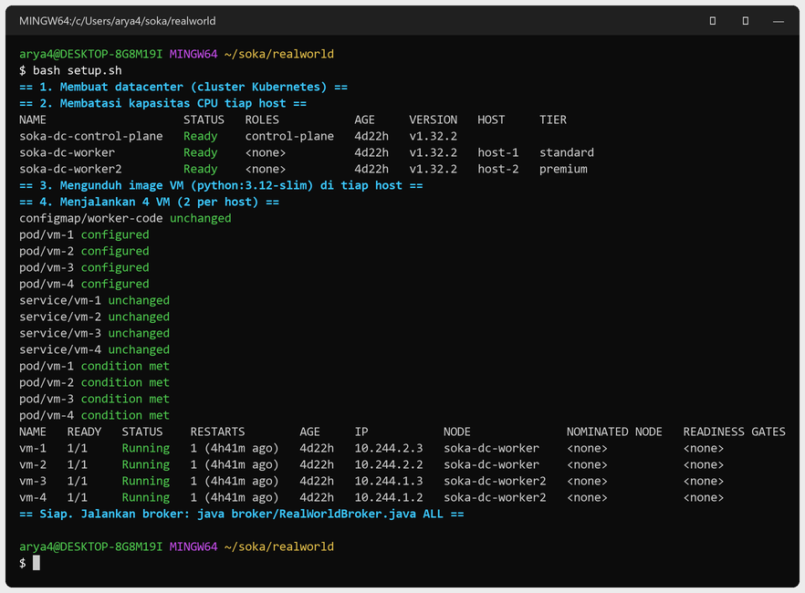</p>

<details><summary>Teks output (dapat disalin)</summary>

```text
arya4@DESKTOP-8G8M19I MINGW64 ~/soka/realworld
$ bash setup.sh
== 1. Membuat datacenter (cluster Kubernetes) ==
== 2. Membatasi kapasitas CPU tiap host ==
NAME                    STATUS   ROLES           AGE     VERSION   HOST     TIER
soka-dc-control-plane   Ready    control-plane   4d22h   v1.32.2
soka-dc-worker          Ready    <none>          4d22h   v1.32.2   host-1   standard
soka-dc-worker2         Ready    <none>          4d22h   v1.32.2   host-2   premium
== 3. Mengunduh image VM (python:3.12-slim) di tiap host ==
== 4. Menjalankan 4 VM (2 per host) ==
configmap/worker-code unchanged
pod/vm-1 configured
pod/vm-2 configured
pod/vm-3 configured
pod/vm-4 configured
service/vm-1 unchanged
service/vm-2 unchanged
service/vm-3 unchanged
service/vm-4 unchanged
pod/vm-1 condition met
pod/vm-2 condition met
pod/vm-3 condition met
pod/vm-4 condition met
NAME   READY   STATUS    RESTARTS        AGE     IP           NODE              NOMINATED NODE   READINESS GATES
vm-1   1/1     Running   1 (4h41m ago)   4d22h   10.244.2.3   soka-dc-worker    <none>           <none>
vm-2   1/1     Running   1 (4h41m ago)   4d22h   10.244.2.2   soka-dc-worker    <none>           <none>
vm-3   1/1     Running   1 (4h41m ago)   4d22h   10.244.1.3   soka-dc-worker2   <none>           <none>
vm-4   1/1     Running   1 (4h41m ago)   4d22h   10.244.1.2   soka-dc-worker2   <none>           <none>
== Siap. Jalankan broker: java broker/RealWorldBroker.java ALL ==
```

</details>

Bukti yang dicatat otomatis oleh `batch.sh` sebelum eksperimen berskala ([`hasil/logs/infrastruktur.txt`](hasil/logs/infrastruktur.txt)):

<p align="center">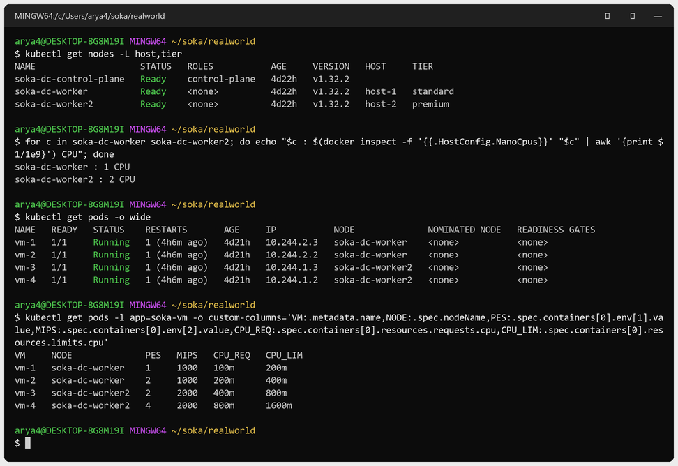</p>

<details><summary>Teks output (dapat disalin)</summary>

```text
arya4@DESKTOP-8G8M19I MINGW64 ~/soka/realworld
$ kubectl get nodes -L host,tier
NAME                    STATUS   ROLES           AGE     VERSION   HOST     TIER
soka-dc-control-plane   Ready    control-plane   4d22h   v1.32.2
soka-dc-worker          Ready    <none>          4d22h   v1.32.2   host-1   standard
soka-dc-worker2         Ready    <none>          4d22h   v1.32.2   host-2   premium
arya4@DESKTOP-8G8M19I MINGW64 ~/soka/realworld
$ for c in soka-dc-worker soka-dc-worker2; do echo "$c : $(docker inspect -f '{{.HostConfig.NanoCpus}}' "$c" | awk '{print $1/1e9}') CPU"; done
soka-dc-worker : 1 CPU
soka-dc-worker2 : 2 CPU
arya4@DESKTOP-8G8M19I MINGW64 ~/soka/realworld
$ kubectl get pods -o wide
NAME   READY   STATUS    RESTARTS       AGE     IP           NODE              NOMINATED NODE   READINESS GATES
vm-1   1/1     Running   1 (4h6m ago)   4d21h   10.244.2.3   soka-dc-worker    <none>           <none>
vm-2   1/1     Running   1 (4h6m ago)   4d21h   10.244.2.2   soka-dc-worker    <none>           <none>
vm-3   1/1     Running   1 (4h6m ago)   4d21h   10.244.1.3   soka-dc-worker2   <none>           <none>
vm-4   1/1     Running   1 (4h6m ago)   4d21h   10.244.1.2   soka-dc-worker2   <none>           <none>
arya4@DESKTOP-8G8M19I MINGW64 ~/soka/realworld
$ kubectl get pods -l app=soka-vm -o custom-columns='VM:.metadata.name,NODE:.spec.nodeName,PES:.spec.containers[0].env[1].value,MIPS:.spec.containers[0].env[2].value,CPU_REQ:.spec.containers[0].resources.requests.cpu,CPU_LIM:.spec.containers[0].resources.limits.cpu'
VM     NODE              PES   MIPS   CPU_REQ   CPU_LIM
vm-1   soka-dc-worker    1     1000   100m      200m
vm-2   soka-dc-worker    2     1000   200m      400m
vm-3   soka-dc-worker2   2     2000   400m      800m
vm-4   soka-dc-worker2   4     2000   800m      1600m
```

</details>

Dari output di atas:
- `kubectl get nodes` menunjukkan **1 datacenter** (`soka-dc`) dengan **2 host**: `soka-dc-worker` = host-1 (standard) dan `soka-dc-worker2` = host-2 (premium). `control-plane` adalah komponen pengendali Kubernetes, bukan host.
- `Batas CPU host` membuktikan host-1 hanya boleh memakai **1 CPU** dan host-2 **2 CPU**.
- `kubectl get pods -o wide` kolom `NODE` membuktikan **2 VM per host**: vm-1 dan vm-2 di host-1, vm-3 dan vm-4 di host-2.
- Tabel terakhir menunjukkan jumlah core (PES), kecepatan (MIPS), dan jatah CPU setiap VM, sama dengan Bagian 3.1.

---

## 4. Alur Eksekusi dan Algoritma

### 4.1 Worker (program di setiap VM)
[`worker/worker.py`](worker/worker.py) menyediakan dua alamat:
- `GET /info`: memberi tahu identitas VM (nama, host, jumlah core, kecepatan).
- `POST /run`: menerima task. Jika core yang dibutuhkan belum tersedia, task **mengantre**. Setelah memperoleh giliran, task **dieksekusi secara nyata** oleh CPU. Worker lalu melaporkan dua angka: `wait` (lama mengantre) dan `exec` (lama dikerjakan).

### 4.2 Broker (program di laptop)
[`broker/RealWorldBroker.java`](broker/RealWorldBroker.java) bekerja dalam enam langkah:

1. **Cek VM**: memastikan keempat VM menyala.
2. **Ukur kecepatan (kalibrasi)**: setiap VM diberi task uji 2.000 MI **satu per satu**, lalu kecepatannya dihitung dari waktu nyata. Angka hasil ukur inilah yang dipakai PEFT, bukan angka tertulis di kode. Hasilnya:

   ```text
   vm-1  :    999 MIPS per PE (1 PE)
   vm-2  :  1,000 MIPS per PE (2 PE)
   vm-3  :  1,998 MIPS per PE (2 PE)
   vm-4  :  1,998 MIPS per PE (4 PE)
   ```
   Hasil ukur hampir persis sama dengan spesifikasi (1.000 dan 2.000 MIPS), artinya pembatas laju bekerja dengan baik saat VM diuji sendirian.
3. **Siapkan dataset** (Bagian 5).
4. **Jadwalkan**: algoritma memutuskan setiap task dikirim ke VM mana.
5. **Kirim dan kerjakan**: setiap task dikirim tepat pada waktu datangnya ke VM pilihan algoritma.
6. **Hitung hasil**: makespan, waktu antre, turnaround, throughput, utilisasi, sebaran task, dan energi.

### 4.3 Cara kerja ketiga algoritma
**PEFT** (sama dengan `PeftBroker.java` di simulasi). Untuk setiap task, PEFT memprediksi kapan task tersebut akan **selesai** di setiap VM, lalu memilih VM yang paling cepat menyelesaikannya:
1. Urutkan task menurut waktu datang; jika datang bersamaan, task terbesar didahulukan.
2. Hanya VM yang core-nya cukup yang boleh dipilih.
3. **Kapan dapat mulai** (EST) = yang lebih lambat antara waktu task datang dan waktu core di VM itu kosong.
4. **Berapa lama dikerjakan** (EET) = ukuran task ÷ kecepatan VM.
5. **Kapan selesai** (EFT) = kapan dapat mulai + berapa lama dikerjakan. Pilih VM dengan EFT paling kecil.

Dalam rumus: $\text{EFT} = \text{EST} + \text{EET} = \max(\text{datang},\ \text{core kosong}) + \frac{\text{ukuran}}{\text{MIPS}}$

**FCFS**: task diurutkan menurut waktu datang, lalu dibagikan **bergiliran** ke VM yang core-nya cukup (VM 1, VM 2, VM 3, VM 4, VM 1, ...).
**RR**: sama-sama bergiliran, tetapi mengikuti urutan task masuk tanpa diurutkan dulu.

FCFS dan RR **tidak melihat ukuran task maupun kecepatan VM**. Akibatnya task berukuran sangat besar dapat ditempatkan pada VM yang lambat. Di GoCJ, semua task datang bersamaan sehingga FCFS dan RR menghasilkan pembagian yang sama persis.

### 4.4 Contoh output terminal broker

Satu kali `java broker/RealWorldBroker.java ALL gocj 30` di terminal (salinan lengkap di [`hasil/batch/gocj_30/run2/log.txt`](hasil/batch/gocj_30/run2/log.txt)).

**Langkah 1 – 3 dan awal langkah 5:** broker mengecek keempat VM, mengukur kecepatannya (kalibrasi), menampilkan profil dataset, lalu mulai mengirim task. Setiap baris eksekusi menunjukkan kapan task selesai, di VM mana, berapa lama mengantre (`tunggu`), dan berapa lama dikerjakan (`eksekusi`).

<p align="center">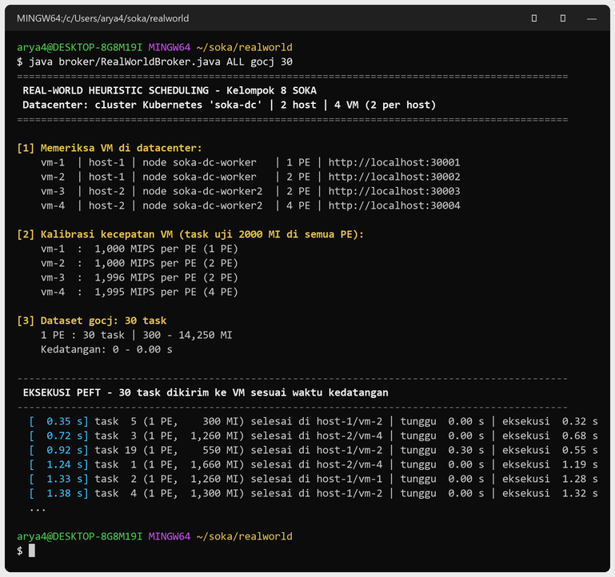</p>

<details><summary>Teks output (dapat disalin)</summary>

```text
arya4@DESKTOP-8G8M19I MINGW64 ~/soka/realworld
$ java broker/RealWorldBroker.java ALL gocj 30
============================================================================================
 REAL-WORLD HEURISTIC SCHEDULING - Kelompok 8 SOKA
 Datacenter: cluster Kubernetes 'soka-dc' | 2 host | 4 VM (2 per host)
============================================================================================

[1] Memeriksa VM di datacenter:
    vm-1  | host-1 | node soka-dc-worker   | 1 PE | http://localhost:30001
    vm-2  | host-1 | node soka-dc-worker   | 2 PE | http://localhost:30002
    vm-3  | host-2 | node soka-dc-worker2  | 2 PE | http://localhost:30003
    vm-4  | host-2 | node soka-dc-worker2  | 4 PE | http://localhost:30004

[2] Kalibrasi kecepatan VM (task uji 2000 MI di semua PE):
    vm-1  :  1,000 MIPS per PE (1 PE)
    vm-2  :  1,000 MIPS per PE (2 PE)
    vm-3  :  1,996 MIPS per PE (2 PE)
    vm-4  :  1,995 MIPS per PE (4 PE)

[3] Dataset gocj: 30 task
    1 PE : 30 task | 300 - 14,250 MI
    Kedatangan: 0 - 0.00 s

--------------------------------------------------------------------------------------------
 EKSEKUSI PEFT - 30 task dikirim ke VM sesuai waktu kedatangan
--------------------------------------------------------------------------------------------
  [  0.35 s] task  5 (1 PE,    300 MI) selesai di host-1/vm-2 | tunggu  0.00 s | eksekusi  0.32 s
  [  0.72 s] task  3 (1 PE,  1,260 MI) selesai di host-2/vm-4 | tunggu  0.00 s | eksekusi  0.68 s
  [  0.92 s] task 19 (1 PE,    550 MI) selesai di host-1/vm-2 | tunggu  0.30 s | eksekusi  0.55 s
  [  1.24 s] task  1 (1 PE,  1,660 MI) selesai di host-2/vm-4 | tunggu  0.00 s | eksekusi  1.19 s
  [  1.33 s] task  2 (1 PE,  1,260 MI) selesai di host-1/vm-1 | tunggu  0.00 s | eksekusi  1.28 s
  [  1.38 s] task  4 (1 PE,  1,300 MI) selesai di host-1/vm-2 | tunggu  0.00 s | eksekusi  1.32 s
  ...
```

</details>

**Langkah 6:** setelah semua task selesai, broker menampilkan sebaran task per VM, hasil setiap algoritma, dan tabel perbandingan di akhir run.

<p align="center">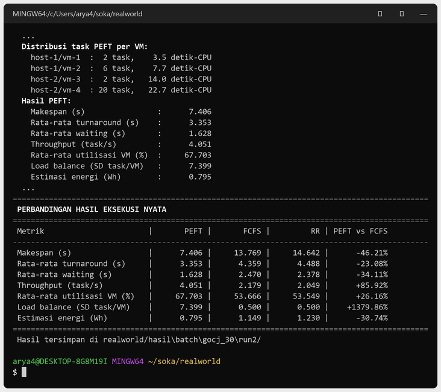</p>

<details><summary>Teks output (dapat disalin)</summary>

```text
  ...
  Distribusi task PEFT per VM:
    host-1/vm-1  :  2 task,    3.5 detik-CPU
    host-1/vm-2  :  6 task,    7.7 detik-CPU
    host-2/vm-3  :  2 task,   14.0 detik-CPU
    host-2/vm-4  : 20 task,   22.7 detik-CPU
  Hasil PEFT:
    Makespan (s)                :      7.406
    Rata-rata turnaround (s)    :      3.353
    Rata-rata waiting (s)       :      1.628
    Throughput (task/s)         :      4.051
    Rata-rata utilisasi VM (%)  :     67.703
    Load balance (SD task/VM)   :      7.399
    Estimasi energi (Wh)        :      0.795
  ...
============================================================================================
 PERBANDINGAN HASIL EKSEKUSI NYATA
============================================================================================
 Metrik                       |       PEFT |       FCFS |         RR | PEFT vs FCFS
--------------------------------------------------------------------------------------------
 Makespan (s)                 |      7.406 |     13.769 |     14.642 |      -46.21%
 Rata-rata turnaround (s)     |      3.353 |      4.359 |      4.488 |      -23.08%
 Rata-rata waiting (s)        |      1.628 |      2.470 |      2.378 |      -34.11%
 Throughput (task/s)          |      4.051 |      2.179 |      2.049 |      +85.92%
 Rata-rata utilisasi VM (%)   |     67.703 |     53.666 |     53.549 |      +26.16%
 Load balance (SD task/VM)    |      7.399 |      0.500 |      0.500 |    +1379.86%
 Estimasi energi (Wh)         |      0.795 |      1.149 |      1.230 |      -30.74%
============================================================================================
 Hasil tersimpan di realworld/hasil\batch\gocj_30\run2/
```

</details>

Di bagian sebaran, PEFT mengirim 20 dari 30 task ke vm-4 (4 core cepat) dan dua job berukuran sangat besar ke vm-3. Di tabel akhir, kolom `PEFT vs FCFS` bernilai negatif untuk makespan, turnaround, waiting, dan energi, artinya PEFT **lebih baik**.

---

## 5. Dataset

Ukuran task diperkecil dari versi simulasi agar satu percobaan selesai dalam hitungan menit, tetapi **komposisinya tetap sama**.

| | GoCJ | Sintetis |
| :--- | :--- | :--- |
| Sumber | 30 job pertama dari [`../dataset/gocj/GoCJ_Dataset_100.txt`](../dataset/gocj/GoCJ_Dataset_100.txt) (Hussain & Aleem, 2018) | Dibuat acak dengan seed 42 (selalu menghasilkan data yang sama) |
| Ukuran task | Ukuran asli ÷ 50 → **300 – 14.250 MI** | 1 core: 644 – 1.957 MI · 2 core: 2.546 – 5.956 MI · 4 core: 6.043 – 10.535 MI |
| Kebutuhan core | Semua 1 core | 9 task 1 core, 12 task 2 core, 9 task 4 core |
| Waktu datang | Semua datang bersamaan di detik 0 | Tersebar antara detik 0 – 14,26 |
| Ciri khas | Ukuran sangat beragam; ada dua job berukuran sangat besar (10.500 dan 14.250 MI) | Banyak task 4 core yang **hanya bisa** dikerjakan vm-4 |

---

## 6. Hasil Eksekusi Real-World

Bagian 6.1 – 6.3 adalah **percobaan pertama** (30 task, 1 kali jalan). Bagian 6.4 adalah **eksperimen berskala** (10 – 50 task, 3 kali jalan).

Sumber: [`hasil/ringkasan_gocj.csv`](hasil/ringkasan_gocj.csv), [`hasil/ringkasan_synthetic.csv`](hasil/ringkasan_synthetic.csv), log lengkap di [`hasil/log_gocj_ALL.txt`](hasil/log_gocj_ALL.txt) dan [`hasil/log_synthetic_ALL.txt`](hasil/log_synthetic_ALL.txt). Angka terbaik di setiap baris ditebalkan. Persentase negatif pada makespan, turnaround, waiting, dan energi berarti PEFT **lebih baik**.

### 6.1 GoCJ, 30 task

| Metrik | PEFT | FCFS | Round Robin | PEFT vs FCFS | PEFT vs RR |
| :--- | ---: | ---: | ---: | ---: | ---: |
| Makespan (s) | **7,61** | 13,83 | 13,85 | -44,99% | -45,07% |
| Rata-rata turnaround (s) | **3,55** | 4,71 | 4,25 | -24,67% | -16,59% |
| Rata-rata waiting (s) | **1,75** | 2,79 | 2,38 | -37,42% | -26,61% |
| Throughput (task/s) | **3,943** | 2,169 | 2,166 | 81,80% | 82,03% |
| Rata-rata utilisasi VM (%) | **67,91** | 53,94 | 53,36 | 25,88% | 27,27% |
| Sebaran task (SD task/VM) | 7,30 | **0,50** | **0,50** | 1.359,45% | 1.359,45% |
| Estimasi energi (Wh) | **0,825** | 1,159 | 1,154 | -28,85% | -28,52% |

### 6.2 Sintetis, 30 task

| Metrik | PEFT | FCFS | Round Robin | PEFT vs FCFS | PEFT vs RR |
| :--- | ---: | ---: | ---: | ---: | ---: |
| Makespan (s) | **47,84** | 49,60 | 49,43 | -3,55% | -3,22% |
| Rata-rata turnaround (s) | **10,90** | 12,59 | 12,29 | -13,39% | -11,27% |
| Rata-rata waiting (s) | **7,52** | 9,38 | 9,05 | -19,80% | -16,86% |
| Throughput (task/s) | **0,627** | 0,605 | 0,607 | 3,68% | 3,33% |
| Rata-rata utilisasi VM (%) | **47,01** | 38,76 | 39,77 | 21,30% | 18,21% |
| Sebaran task (SD task/VM) | **3,04** | 4,50 | 4,50 | -32,41% | -32,41% |
| Estimasi energi (Wh) | 4,951 | **4,868** | 4,885 | 1,71% | 1,35% |

### 6.3 Distribusi task per VM

Format sel: **jumlah task · total detik kerja CPU**.

| VM | GoCJ PEFT | GoCJ FCFS | GoCJ RR | Sintetis PEFT | Sintetis FCFS | Sintetis RR |
| :--- | ---: | ---: | ---: | ---: | ---: | ---: |
| vm-1 (host-1, 1 core × 1.000) | 3 · 3,7 | 8 · 13,4 | 8 · 13,4 | 4 · 5,5 | 3 · 3,6 | 3 · 4,1 |
| vm-2 (host-1, 2 core × 1.000) | 5 · 7,5 | 8 · 21,7 | 8 · 21,7 | 5 · 26,7 | 6 · 31,8 | 6 · 31,7 |
| vm-3 (host-2, 2 core × 2.000) | 2 · 13,9 | 7 · 5,2 | 7 · 4,9 | 10 · 51,9 | 6 · 25,3 | 6 · 27,0 |
| vm-4 (host-2, 4 core × 2.000) | 20 · 25,0 | 7 · 12,0 | 7 · 11,4 | 11 · 180,6 | 15 · 178,8 | 15 · 180,9 |

Tabel ini menjelaskan hasil di atas:
- **GoCJ**: FCFS/RR membagi rata (7 – 8 task per VM) tanpa melihat ukuran. Akibatnya job berukuran sangat besar ikut ditempatkan pada VM lambat: task 21 (10.500 MI) dikerjakan vm-2 yang lambat dan membutuhkan 10,50 detik. PEFT mempertimbangkan ukuran task dan kecepatan VM: kedua job berukuran sangat besar dikirim ke vm-3 yang cepat, dan 20 job kecil dikumpulkan di vm-4 yang memiliki 4 core cepat.
- **Sintetis**: kesembilan task 4 core **wajib** dikerjakan vm-4 (satu-satunya VM dengan 4 core), algoritma apa pun yang dipakai. vm-4 menjadi ***bottleneck*** (sekitar 180 detik kerja di ketiga algoritma). PEFT hanya dapat mengatur task 1 dan 2 core, sehingga selisih makespan-nya kecil. Meski demikian, waktu antre dan turnaround PEFT tetap lebih singkat.

### 6.4 Eksperimen berskala: 10 – 50 task, rata-rata 3 run

Sumber: [`hasil/batch/`](hasil/batch) (setiap run memiliki `log.txt`, `ringkasan_*.csv`, dan `task_*.csv`), ringkasan di [`hasil/batch_tabel.md`](hasil/batch_tabel.md). Angka `± SD` adalah simpangan baku antar-3 run: semakin kecil, semakin konsisten hasilnya. Data sintetis 50 task **tidak tersedia** karena tidak dapat diukur dengan bersih (Bagian 9).

**GoCJ**

| Task | Algoritma | Makespan (s) | Turnaround (s) | Waiting (s) | Throughput (task/s) | Utilisasi VM (%) | SD task/VM | Energi (Wh) |
| ---: | :--- | ---: | ---: | ---: | ---: | ---: | ---: | ---: |
| 10 | PEFT | 1,37 ± 0,06 | 1,00 | 0,01 ± 0,00 | 7,312 | 78,05 | 1,50 | 0,147 |
| 10 | FCFS | 6,04 ± 0,05 | 1,82 | 0,59 ± 0,07 | 1,655 | 34,70 | 0,50 | 0,448 |
| 10 | RR | 6,03 ± 0,09 | 1,99 | 0,73 ± 0,05 | 1,658 | 34,77 | 0,50 | 0,447 |
| 20 | PEFT | 8,26 ± 0,77 | 2,33 | 0,81 ± 0,07 | 2,443 | 35,91 | 3,90 | 0,728 |
| 20 | FCFS | 8,89 ± 1,00 | 2,95 | 1,29 ± 0,11 | 2,276 | 48,30 | 0,00 | 0,747 |
| 20 | RR | 8,66 ± 0,38 | 3,19 | 1,47 ± 0,19 | 2,315 | 50,11 | 0,00 | 0,737 |
| 30 | PEFT | 7,55 ± 0,32 | 3,25 | 1,54 ± 0,10 | 3,980 | 66,36 | 7,37 | 0,802 |
| 30 | FCFS | 15,02 ± 1,02 | 4,41 | 2,50 ± 0,02 | 2,006 | 49,54 | 0,50 | 1,231 |
| 30 | RR | 14,63 ± 0,22 | 5,01 | 2,94 ± 0,40 | 2,052 | 53,65 | 0,50 | 1,227 |
| 40 | PEFT | 10,31 ± 3,91 | 4,30 | 2,35 ± 0,48 | 4,375 | 73,27 | 9,39 | 1,121 |
| 40 | FCFS | 22,58 ± 3,47 | 7,04 | 4,53 ± 1,96 | 1,812 | 53,07 | 0,00 | 1,908 |
| 40 | RR | 24,74 ± 10,37 | 8,49 | 5,37 ± 2,68 | 1,872 | 59,04 | 0,00 | 2,165 |
| 50 | PEFT | 15,91 ± 1,26 | 5,94 | 3,56 ± 0,35 | 3,162 | 70,88 | 6,78 | 1,692 |
| 50 | FCFS | 38,55 ± 5,43 | 8,99 | 5,94 ± 1,25 | 1,321 | 45,38 | 0,50 | 3,139 |
| 50 | RR | 33,38 ± 1,55 | 8,18 | 5,43 ± 0,64 | 1,501 | 48,00 | 0,50 | 2,750 |

**Sintetis**

| Task | Algoritma | Makespan (s) | Turnaround (s) | Waiting (s) | Throughput (task/s) | Utilisasi VM (%) | SD task/VM | Energi (Wh) |
| ---: | :--- | ---: | ---: | ---: | ---: | ---: | ---: | ---: |
| 10 | PEFT | 22,01 ± 0,94 | 5,02 | 1,47 ± 0,27 | 0,455 | 36,13 | 2,75 | 2,177 |
| 10 | FCFS | 22,13 ± 1,79 | 4,81 | 1,24 ± 0,25 | 0,455 | 35,78 | 1,12 | 2,101 |
| 10 | RR | 22,35 ± 2,52 | 4,78 | 1,38 ± 0,29 | 0,453 | 32,42 | 1,12 | 2,072 |
| 20 | PEFT | 38,31 ± 1,27 | 8,09 | 4,70 ± 0,24 | 0,523 | 36,90 | 3,94 | 3,779 |
| 20 | FCFS | 36,68 ± 1,85 | 7,90 | 4,42 ± 0,48 | 0,547 | 40,54 | 2,55 | 3,611 |
| 20 | RR | 35,93 ± 2,21 | 7,41 | 4,02 ± 0,24 | 0,559 | 40,21 | 2,55 | 3,533 |
| 30 | PEFT | 56,23 ± 2,16 | 13,33 | 9,18 ± 0,47 | 0,534 | 44,68 | 2,74 | 5,757 |
| 30 | FCFS | 55,21 ± 2,34 | 14,73 | 10,92 ± 0,69 | 0,544 | 37,70 | 4,50 | 5,384 |
| 30 | RR | 54,00 ± 2,46 | 13,53 | 9,82 ± 0,59 | 0,557 | 38,94 | 4,50 | 5,311 |
| 40 | PEFT | 79,21 ± 2,44 | 19,04 | 14,41 ± 0,33 | 0,505 | 44,82 | 2,46 | 8,105 |
| 40 | FCFS | 76,61 ± 1,36 | 20,84 | 16,61 ± 0,29 | 0,522 | 38,42 | 6,20 | 7,516 |
| 40 | RR | 75,66 ± 3,44 | 21,15 | 16,89 ± 0,65 | 0,530 | 38,51 | 6,20 | 7,413 |

Dari tabel di atas:
- **GoCJ**: makespan PEFT selalu paling kecil, dan selisihnya semakin besar saat task bertambah (pada 50 task: 15,91 detik vs 38,55 detik FCFS). Utilisasi VM PEFT juga paling tinggi (66 – 78%), artinya VM lebih jarang menganggur.
- **Sintetis**: kinerja ketiga algoritma hampir setara. Makespan PEFT justru sedikit lebih besar pada 20 – 40 task, tetapi waktu antre PEFT paling kecil pada 30 – 40 task. Alasannya dibahas di Bagian 8.10 dan 8.15.
- **Mengapa sintetis 30 task di sini (56,23 detik) lebih lambat daripada percobaan pertama (47,84 detik)?** Datasetnya sama persis, tetapi laptopnya tidak dalam kondisi yang sama. Pemeriksaan kecepatan hanya menguji 1 core per VM, sehingga perlambatan ringan saat semua core sibuk tetap dapat lolos (Bagian 12). Selisih antar-sesi ini adalah contoh lain bahwa hasil di dunia nyata **tidak pernah persis sama** dari waktu ke waktu, berbeda dengan simulasi yang selalu memberi angka identik.

---

## 7. Cara Membandingkan Simulasi dengan Dunia Nyata

Hasil nyata (30 task, 4 VM) tidak dapat langsung dibandingkan dengan hasil CloudSim di folder induk (1.000 task, 30 – 40 VM), karena skala infrastruktur dan beban kerjanya berbeda jauh, sehingga perbandingan langsung tidak setara.

Karena itu dibuat **kembaran simulasi** ([`analisis/bandingkan_simulasi.py`](analisis/bandingkan_simulasi.py)). Untuk setiap percobaan nyata, skrip mengulang percobaan yang **sama persis** di kondisi ideal:

| Aspek | Kembaran simulasi | Dunia nyata |
| :--- | :--- | :--- |
| Task, ukuran, kebutuhan core, waktu datang | Sama persis | Sama persis |
| Task dikirim ke VM mana | Sama persis (diambil dari keputusan algoritma di percobaan nyata) | Sama persis |
| Kecepatan VM | Selalu tepat 1.000 / 2.000 MIPS | Diukur; bisa turun jika host sibuk |
| Jeda pengiriman & jaringan | Nol | Ada (pengiriman HTTP, Docker, Python) |
| Aturan antrean di VM | CloudSim: *backfilling* (task yang kebutuhan core-nya terpenuhi dapat dieksekusi lebih dahulu) | Worker: FIFO ketat (task harus menunggu task di depannya) |

Karena keputusan algoritmanya sama, **setiap perbedaan hasil pasti disebabkan oleh dunia nyata.**

Skrip juga membuat versi ketiga, **"simulasi FIFO ketat"**: kondisi ideal, tetapi dengan aturan antrean worker (tanpa *backfilling*). Dengan demikian, dapat dipisahkan dua hal: berapa bagian selisih yang disebabkan **aturan antrean** dan berapa yang disebabkan **mesin yang melambat**.

| Berkas keluaran | Isi |
| :--- | :--- |
| [`hasil/perbandingan_sim_vs_real.csv`](hasil/perbandingan_sim_vs_real.csv) | Semua metrik: simulasi, simulasi FIFO ketat, nyata, dan selisihnya (%) |
| [`hasil/dekomposisi_overhead.csv`](hasil/dekomposisi_overhead.csv) | Jeda pengiriman, jeda jaringan, dan seberapa lambat VM dibanding spesifikasinya |
| [`grafik/*.png`](grafik) | Grafik di Bagian 8 |

### 7.1 Validasi kondisi pengukuran (eksperimen berskala)

Eksperimen berskala dijalankan otomatis oleh [`batch.sh`](batch.sh): 2 dataset × 5 skala × 3 run, masing-masing menjalankan PEFT, FCFS, dan RR. Karena laptop juga dipakai untuk hal lain, setiap run dijaga oleh **pemeriksaan kecepatan**:

1. **Sebelum run**: setiap VM diberi task uji 2.000 MI sendirian. Jika ada VM yang berjalan di bawah **95%** spesifikasinya, laptop sedang sibuk. Skrip menunggu dan mengecek lagi setiap 60 detik (maksimal 30 menit).
2. **Sesudah run**: pengecekan diulang. Jika gagal, berarti ada gangguan di tengah run.
3. Run yang gagal **dibuang** ke [`hasil/batch_terganggu/`](hasil/batch_terganggu) dan diulang (maksimal 5 kali).

Contoh output terminal ([`hasil/logs/batch_ulang.txt`](hasil/logs/batch_ulang.txt)). Run pertama lolos, run kedua dibuang karena vm-1 tiba-tiba turun ke 531 MIPS di tengah run, lalu diulang dan lolos:

<p align="center">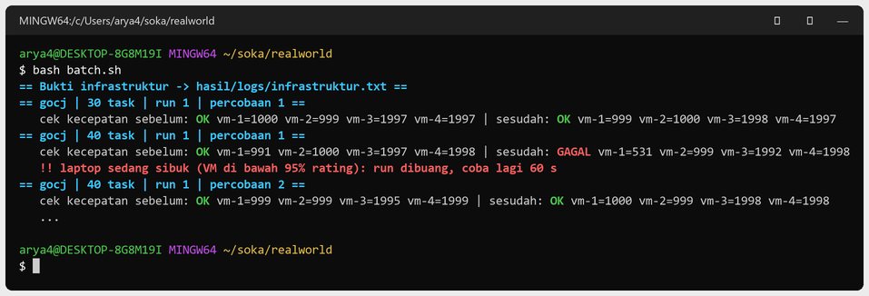</p>

<details><summary>Teks output (dapat disalin)</summary>

```text
arya4@DESKTOP-8G8M19I MINGW64 ~/soka/realworld
$ bash batch.sh
== Bukti infrastruktur -> hasil/logs/infrastruktur.txt ==
== gocj | 30 task | run 1 | percobaan 1 ==
   cek kecepatan sebelum: OK vm-1=1000 vm-2=999 vm-3=1997 vm-4=1997 | sesudah: OK vm-1=999 vm-2=1000 vm-3=1998 vm-4=1997
== gocj | 40 task | run 1 | percobaan 1 ==
   cek kecepatan sebelum: OK vm-1=991 vm-2=1000 vm-3=1997 vm-4=1998 | sesudah: GAGAL vm-1=531 vm-2=999 vm-3=1992 vm-4=1998
   !! laptop sedang sibuk (VM di bawah 95% rating): run dibuang, coba lagi 60 s
== gocj | 40 task | run 1 | percobaan 2 ==
   cek kecepatan sebelum: OK vm-1=999 vm-2=999 vm-3=1995 vm-4=1999 | sesudah: OK vm-1=1000 vm-2=999 vm-3=1998 vm-4=1998
   ...
```

</details>

Hasil akhirnya: **27 run bersih** (GoCJ 10 – 50 task dan sintetis 10 – 40 task, masing-masing 3 run). Untuk setiap run bersih, skrip analisis membuat kembaran simulasinya, lalu hasilnya dirata-rata per skala.

---

## 8. Grafik dan Analisis Simulasi vs Real-World

Warna sama di semua grafik: **biru = simulasi**, **oranye = dunia nyata**. Setiap grafik langsung diikuti penjelasannya dalam dua bagian: **apa yang terlihat** dan **mengapa terjadi**. Urutannya dari gejala (waktu selesai), lalu penyebab, lalu dampaknya pada keunggulan PEFT.

Bagian 8.1 – 8.9 memakai **percobaan pertama** (30 task, 1 run) dan menjelaskan penyebab perbedaan sampai ke tingkat task. Bagian 8.10 – 8.16 memakai **eksperimen berskala** (10 – 50 task, 3 run) untuk mengecek apakah temuan itu tetap berlaku di skala lain.

### 8.1 Makespan (waktu sampai semua task selesai)
<p align="center">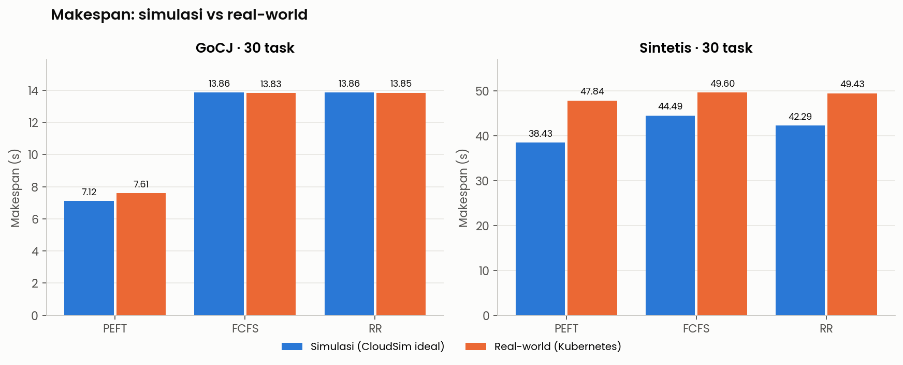</p>

| Dataset | Algoritma | Simulasi (s) | Nyata (s) | Selisih |
| :--- | :--- | ---: | ---: | ---: |
| GoCJ | PEFT | 7,13 | 7,61 | +6,78% |
| GoCJ | FCFS | 13,86 | 13,83 | -0,20% |
| GoCJ | RR | 13,86 | 13,85 | -0,07% |
| Sintetis | PEFT | 38,43 | 47,84 | **+24,48%** |
| Sintetis | FCFS | 44,49 | 49,60 | +11,49% |
| Sintetis | RR | 42,29 | 49,43 | +16,87% |

**Apa yang terlihat.**
- Dunia nyata hampir selalu sedikit lebih lambat, tetapi selisihnya **sangat tidak merata**: hampir nol untuk GoCJ FCFS/RR, tetapi hampir seperempat untuk sintetis PEFT.
- **Peringkat algoritma tidak berubah**: PEFT tetap paling cepat di kedua dataset, baik di simulasi maupun di dunia nyata.

**Mengapa terjadi.**
- Makespan ditentukan oleh **VM yang paling akhir selesai** (*critical path*). Oleh karena itu, makespan nyata hanya menyimpang apabila VM pada *critical path* tersebut melambat.
- **Sintetis**: VM paling akhir selalu vm-4 (tempat semua task 4 core). vm-4 berada di host-2 yang paling sibuk (Bagian 8.2), sehingga makespan ikut membengkak.
- **GoCJ PEFT**: VM paling akhir adalah vm-3, yang mengerjakan job berukuran sangat besar 14.250 MI (7,37 detik nyata vs 7,13 detik ideal). vm-4 sebenarnya melambat jauh lebih besar (+57,8%), tetapi tetap selesai lebih dulu (detik 6,66). Keterlambatan vm-4 tidak berada pada *critical path* karena vm-3 selesai lebih akhir, sehingga makespan hanya naik 6,78%.
- **GoCJ FCFS/RR**: VM paling akhir berada di host-1, yang tidak pernah melambat. Karena itu hasilnya hampir persis sama dengan simulasi.

### 8.2 Beban per VM: penyebab utama adalah kontensi CPU di host
<p align="center">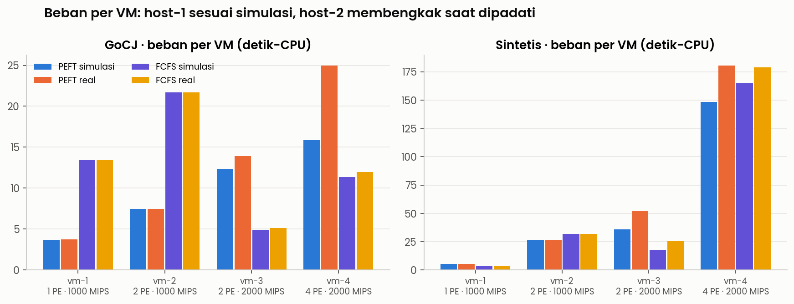</p>

Seberapa lambat setiap VM bekerja dibanding spesifikasinya (0% = tepat sesuai spesifikasi):

| Percobaan | vm-1 (host-1) | vm-2 (host-1) | vm-3 (host-2) | vm-4 (host-2) | Total kerja di host-2 (detik-CPU) |
| :--- | ---: | ---: | ---: | ---: | ---: |
| GoCJ PEFT | +0,9% | +0,1% | +12,2% | **+57,8%** | 38,9 |
| GoCJ FCFS | +0,1% | +0,0% | +5,4% | +5,7% | 17,2 |
| GoCJ RR | +0,1% | +0,1% | +0,1% | +0,1% | 16,3 |
| Sintetis PEFT | +1,0% | +0,0% | **+42,7%** | +21,2% | 232,5 |
| Sintetis FCFS | +0,5% | +0,1% | +38,9% | +8,2% | 204,2 |
| Sintetis RR | +0,4% | +0,2% | +38,6% | +9,5% | 207,8 |

**Apa yang terlihat.**
- Task dikirim ke VM yang sama di simulasi dan di dunia nyata. Oleh karena itu, jika batang oranye lebih tinggi dari biru, artinya VM itu **bekerja lebih lambat** dari seharusnya.
- **host-1** (vm-1, vm-2): batang simulasi dan nyata hampir sama tinggi. VM di host-1 tidak pernah melambat lebih dari 1%.
- **host-2** (vm-3, vm-4): batang nyata lebih tinggi. Perlambatan terbesar terjadi pada vm-4 di GoCJ PEFT (15,8 → 25,0 detik kerja) dan vm-3 di sintetis PEFT (36,1 → 51,8 detik kerja). **Semakin banyak kerja yang ditumpuk di host-2, semakin lambat VM-nya.**

**Mengapa terjadi.**
- **host-1 tidak pernah jenuh.** VM 1.000 MIPS hanya membutuhkan sedikit CPU. Ketiga core di host-1 memakai sekitar 30% dari 1 CPU yang tersedia, sehingga kapasitasnya masih tersisa banyak.
- **host-2 dapat jenuh.** Enam core 2.000 MIPS di host-2 membutuhkan sekitar 1,2 dari 2 CPU yang tersedia. Selain itu, terdapat proses pendukung yang juga membutuhkan CPU: Python, server HTTP di worker, program Kubernetes, dan aplikasi lain di laptop. Ketika seluruh core aktif bersamaan, kapasitas CPU tidak mencukupi. Karena pembatas laju worker hanya dapat memperlambat (Bagian 3.2), VM berjalan di bawah spesifikasinya.
- **Simulasi tidak memodelkan kondisi ini.** CloudSim menganggap setiap VM memiliki CPU sendiri yang tidak dapat diganggu VM lain. Di lingkungan nyata, VM pada host yang sama berbagi CPU fisik, sehingga beban satu VM menurunkan kinerja VM lain (*noisy neighbor*).
- **PEFT paling dirugikan.** PEFT selalu memilih VM yang diprediksi paling cepat selesai, dan itu hampir selalu VM 2.000 MIPS di host-2. Akibatnya PEFT menumpuk pekerjaan di host-2 (GoCJ: 22 dari 30 task; sintetis: 232,5 detik kerja vs ~205 pada FCFS/RR). Semakin padat host-2, semakin tinggi kontensinya. Dengan kata lain, **prediksi PEFT benar secara teoretis, tetapi keputusan penjadwalan berdasarkan prediksi tersebut justru mengubah kondisi yang diprediksi.**
- **Mengapa prediksi PEFT tidak memperhitungkan hal ini?** Kecepatan VM diukur (langkah kalibrasi) **satu per satu saat host kosong**, sehingga hasilnya tepat 1.998 MIPS. Saat percobaan, VM tersebut berjalan bersamaan dengan VM lain sehingga kecepatan efektifnya turun. Akibatnya, estimasi waktu eksekusi (EET) yang digunakan PEFT terlalu optimis.

### 8.3 Memisahkan dua penyebab: aturan antrean vs mesin melambat
<p align="center">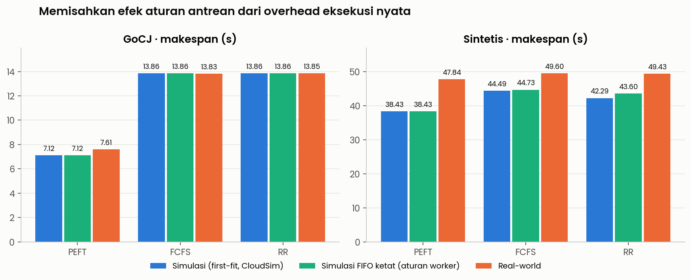</p>

| Percobaan | Waiting simulasi | Waiting simulasi FIFO ketat | Waiting nyata | Porsi selisih karena aturan antrean |
| :--- | ---: | ---: | ---: | ---: |
| Sintetis PEFT | 4,74 s | 4,74 s | 7,52 s | 0% |
| Sintetis FCFS | 5,63 s | 7,73 s | 9,38 s | **56%** |
| Sintetis RR | 5,02 s | 6,99 s | 9,05 s | **49%** |

**Apa yang terlihat.**
- Batang hijau adalah simulasi yang memakai aturan antrean worker (FIFO ketat), tetapi kecepatan VM tetap ideal.
  - Jarak **biru → hijau** = selisih karena **aturan antrean**.
  - Jarak **hijau → oranye** = selisih karena **mesin melambat** di dunia nyata.
- Untuk **PEFT** dan seluruh **GoCJ**, biru dan hijau sama tinggi. Artinya seluruh selisih mereka disebabkan mesin yang melambat (Bagian 8.2).
- Untuk **FCFS/RR sintetis**, aturan antrean menyumbang sekitar **separuh** tambahan waktu antre.

**Mengapa terjadi.**
- CloudSim menerapkan ***backfilling***: apabila task terdepan membutuhkan 4 core sementara baru tersedia 1 core, task di belakangnya yang hanya membutuhkan 1 core dapat dieksekusi lebih dahulu. Worker menerapkan **FIFO ketat**: task di belakang harus menunggu task di depannya meskipun ada core yang menganggur (*head-of-line blocking*).
- Masalah ini hanya muncul jika satu VM menerima campuran task kecil dan besar, yaitu vm-4 di data sintetis. Di GoCJ semua task 1 core, sehingga kedua aturan memberi hasil yang sama.
- FCFS/RR mengirim task kecil ke vm-4 secara bergiliran tanpa melihat isi antreannya, sehingga task kecil sering tertahan di belakang task 4 core. PEFT tidak terdampak karena saat memprediksi, PEFT sudah menghitung kapan core di VM itu benar-benar kosong. Di percobaan ini, PEFT tidak pernah menaruh task kecil di belakang task besar yang menghalanginya.

### 8.4 Waktu antre (waiting) dan turnaround
<p align="center">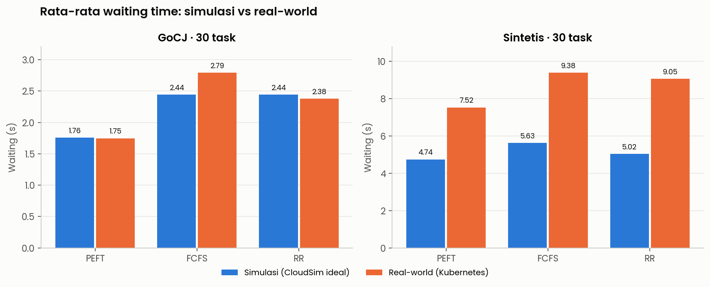</p>
<p align="center">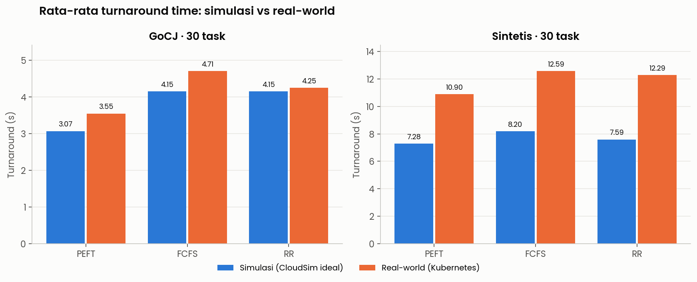</p>

| Dataset | Algoritma | Waiting sim (s) | Waiting nyata (s) | Selisih | Turnaround sim (s) | Turnaround nyata (s) | Selisih |
| :--- | :--- | ---: | ---: | ---: | ---: | ---: | ---: |
| GoCJ | PEFT | 1,76 | 1,75 | -0,54% | 3,07 | 3,55 | +15,55% |
| GoCJ | FCFS | 2,44 | 2,79 | +14,35% | 4,15 | 4,71 | +13,36% |
| GoCJ | RR | 2,44 | 2,38 | -2,50% | 4,15 | 4,25 | +2,38% |
| Sintetis | PEFT | 4,74 | 7,52 | +58,69% | 7,28 | 10,90 | +49,69% |
| Sintetis | FCFS | 5,63 | 9,38 | +66,65% | 8,20 | 12,59 | +53,55% |
| Sintetis | RR | 5,02 | 9,05 | +80,05% | 7,59 | 12,29 | +61,87% |

Jeda tambahan yang tidak ada di simulasi:

| Percobaan | Jeda pengiriman rata-rata | Jeda jaringan/HTTP rata-rata |
| :--- | ---: | ---: |
| GoCJ PEFT / FCFS / RR | 10,0 / 3,2 / 2,3 ms | 130 / 174 / 159 ms |
| Sintetis PEFT / FCFS / RR | 8,9 / 8,6 / 7,4 ms | 302 / 387 / 396 ms |

**Apa yang terlihat.**
- Pada sintetis, selisih waktu antre (**+50 – 80%**) jauh lebih besar daripada selisih makespan (+11 – 24%).
- Pada GoCJ, waktu antre PEFT dan RR hampir sama dengan simulasi, tetapi turnaround-nya tetap lebih besar.

**Mengapa terjadi.**
- **Keterlambatan berakumulasi di antrean.** Apabila satu task dieksekusi sedikit lebih lama, **seluruh** task di belakangnya ikut menunggu lebih lama. Di sintetis, antrean vm-4 panjang (11 – 15 task), sehingga keterlambatan kecil per task (Bagian 8.2) ditambah masalah FIFO ketat (Bagian 8.3) menumpuk menjadi +59 – 80%.
- **Turnaround memuat jeda jaringan, waiting tidak.** Setiap task harus dikirim lewat jaringan dan hasilnya dikirim balik. Di laptop Windows, jalurnya panjang: Windows → WSL2 → Docker → Kubernetes → pod. Jeda ini (0,1 – 0,4 detik per task) tidak mengubah waktu antre, tetapi menambah turnaround. Untuk task GoCJ yang pendek (1 – 2 detik), 0,13 – 0,17 detik itu cukup terasa.
- Jeda jaringan di host-2 yang sibuk lebih besar (sintetis PEFT: 388 ms) dibanding host-1 (103 ms). Ini cocok dengan Bagian 8.2: server HTTP di worker juga ikut bersaing memakai CPU.

### 8.5 Waktu selesai setiap task
<p align="center">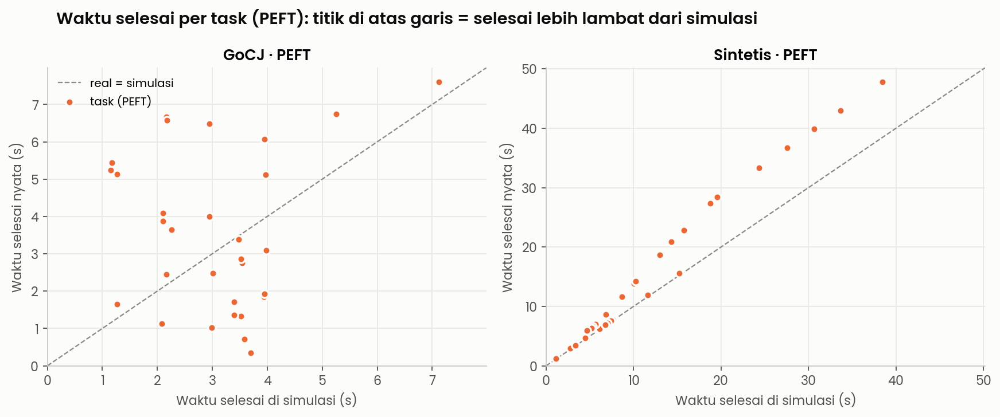</p>

Setiap titik adalah satu task. Sumbu mendatar = kapan task selesai di simulasi, sumbu tegak = kapan selesai di dunia nyata. Titik **tepat di garis putus-putus** berarti nyata = simulasi; titik **di atas garis** berarti selesai lebih lambat.

**Apa yang terlihat.**
- **Sintetis**: titik-titik tersusun konsisten di atas garis, dan semakin ke kanan semakin jauh dari garis.
- **GoCJ**: titik-titik tersebar acak di atas dan di bawah garis. Ada task yang selesai lebih cepat dari simulasi, ada yang lebih lambat.

**Mengapa terjadi.**
- **Sintetis**: keterlambatan terjadi **terus-menerus dan menumpuk**. Setiap task di vm-4 sedikit lebih lambat, lalu task berikutnya mewarisi keterlambatan itu. Ini merupakan pola yang konsisten, bukan variasi acak.
- **GoCJ**: terjadi ***race condition* urutan kedatangan**. Semua 30 task dikirim pada detik yang sama, sehingga urutan tibanya di VM bersifat acak. Di simulasi, urutannya selalu deterministik (task terbesar lebih dahulu). Akibatnya, task yang sama dapat memperoleh giliran awal pada satu percobaan dan giliran akhir pada percobaan lain.
- Perlu dicatat bahwa urutan antrean hanya menentukan **siapa** yang menunggu, bukan **kapan VM selesai** mengerjakan semuanya. Karena itu, walaupun waktu selesai per task acak, makespan dan rata-rata waktu antre GoCJ tetap dekat dengan simulasi (PEFT: 1,76 detik vs 1,75 detik). Di sintetis, task datang bergantian sepanjang 0 – 14 detik, sehingga *race condition* urutan kedatangan jarang terjadi.

### 8.6 Kurva penyelesaian task
<p align="center">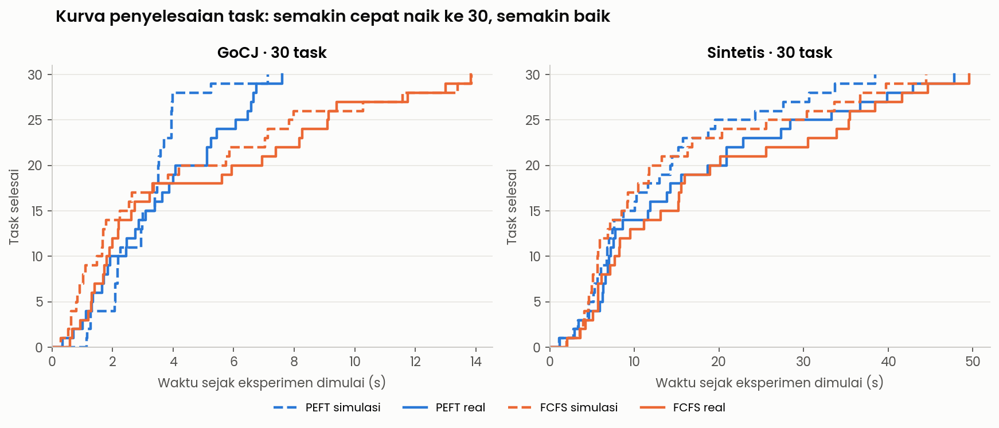</p>

Kurva menunjukkan **berapa task yang sudah selesai** di setiap detik. Garis putus-putus = simulasi, garis utuh = nyata. Semakin cepat kurva naik ke angka 30, semakin baik.

**Apa yang terlihat.**
- **Sintetis**: kurva nyata berimpit dengan simulasi selama sekitar 10 detik pertama, lalu mulai tertinggal.
- **GoCJ**: kurva PEFT nyata (biru utuh) melandai di detik 4 – 7, sedangkan kurva FCFS nyata hampir berimpit dengan simulasinya.
- Di kedua dataset, kurva **PEFT tetap mencapai 30 lebih dulu** daripada FCFS, baik di simulasi maupun nyata.

**Mengapa terjadi.**
- **Sintetis** tertinggal setelah detik ke-10 karena saat itulah task 4 core mulai menumpuk di vm-4 dan host-2 mulai jenuh. Sebelumnya beban masih ringan, sehingga hasil nyata sesuai dengan simulasi.
- **GoCJ PEFT** melandai karena di rentang itu vm-4 sedang mengerjakan 20 job dengan kecepatan di bawah spesifikasi (+57,8%, Bagian 8.2). FCFS banyak memakai host-1 yang tidak pernah jenuh, sehingga kurvanya tetap sesuai simulasi.

### 8.7 Energi
<p align="center">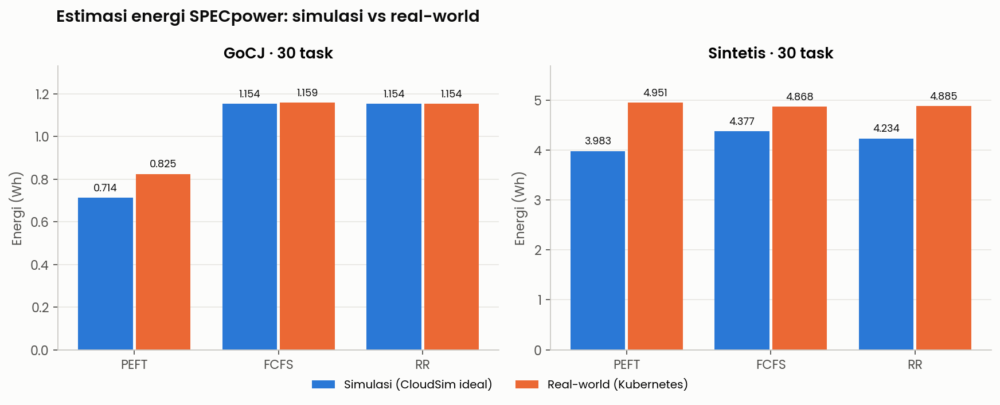</p>

**Apa yang terlihat.**
- Energi nyata **selalu sama atau lebih besar** dari simulasi (+0,4% sampai +24,3%).
- Pada sintetis, PEFT berubah dari **paling hemat** di simulasi (3,98 Wh vs 4,38 Wh FCFS) menjadi **paling boros** di dunia nyata (4,95 Wh vs 4,87 Wh).

**Mengapa terjadi.**
- Energi = (daya sibuk × lama sibuk) + (daya idle × lama menganggur) (Bagian 3.3). Di dunia nyata keduanya naik: VM yang melambat membuat host **lebih lama sibuk**, dan makespan yang lebih panjang membuat host **lebih lama menyala**.
- PEFT paling terdampak karena bebannya menumpuk di host-2, yang **paling boros listrik** (300 W saat sibuk vs 135 W host-1) **sekaligus paling melambat**. Waktu eksekusi tambahan akibat kontensi CPU terjadi pada host dengan konsumsi daya tertinggi.

### 8.8 Apakah keunggulan PEFT bertahan di dunia nyata?
<p align="center">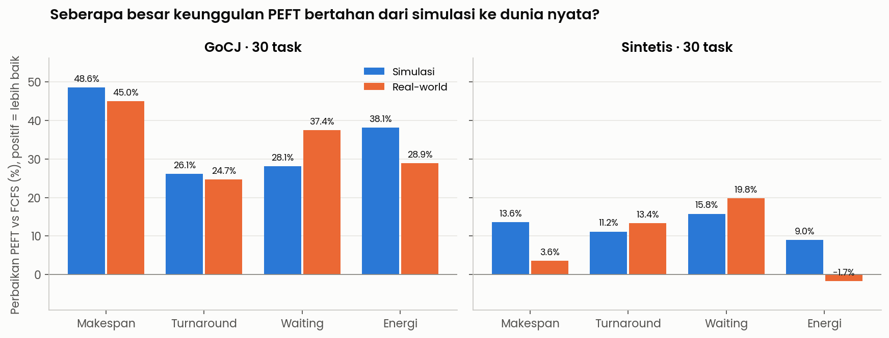</p>

Angka = seberapa jauh PEFT lebih baik daripada FCFS (positif = PEFT lebih baik).

| Metrik | GoCJ simulasi | GoCJ nyata | Sintetis simulasi | Sintetis nyata |
| :--- | ---: | ---: | ---: | ---: |
| Makespan | 48,6% | 45,0% | 13,6% | **3,6%** |
| Turnaround | 26,1% | 24,7% | 11,2% | 13,4% |
| Waiting | 28,1% | 37,4% | 15,8% | 19,8% |
| Energi | 38,1% | 28,9% | 9,0% | **-1,7%** |

**Apa yang terlihat.**
- **PEFT tetap menang** untuk makespan, turnaround, dan waktu antre di kedua dataset.
- Keunggulan PEFT dalam **waktu antre** justru sedikit **membesar** di dunia nyata.
- Yang menyusut tajam adalah keunggulan **makespan dan energi di data sintetis** (13,6% → 3,6%; 9,0% → -1,7%).

**Mengapa terjadi.**
- Keunggulan waktu antre membesar karena FCFS/RR terdampak **dua faktor** di dunia nyata (kontensi CPU + FIFO ketat, Bagian 8.3), sedangkan PEFT hanya terdampak **satu** (kontensi CPU).
- Keunggulan makespan dan energi menyusut karena PEFT menumpuk pekerjaan di host-2, dan host-2 itulah yang paling melambat (Bagian 8.2). FCFS/RR menyebar pekerjaan ke host-1 yang tidak pernah melambat, sehingga lebih terlindung dari kontensi CPU.
- Di GoCJ, keunggulan PEFT hampir utuh (48,6% → 45,0%) karena VM paling akhir PEFT adalah vm-3, yang hanya sedikit melambat (Bagian 8.1).

### 8.9 Ringkasan: mengapa dunia nyata berbeda dari simulasi?

| Penyebab | Ada di simulasi? | Yang terpengaruh | Seberapa besar | Paling merugikan | Bagian |
| :--- | :---: | :--- | :--- | :--- | :---: |
| **Kontensi CPU di host** | Tidak (setiap VM dianggap memiliki CPU sendiri) | Makespan, energi, semua waktu | VM di host-2 sampai 58% lebih lambat | PEFT (menumpuk task di host cepat) | 8.1, 8.2 |
| **FIFO ketat (*head-of-line blocking*)** | Tidak (CloudSim menerapkan *backfilling*) | Waktu antre, turnaround | Sekitar separuh tambahan waktu antre FCFS/RR | FCFS, RR | 8.3 |
| **Jeda jaringan** | Tidak (jeda nol) | Turnaround | 0,1 – 0,4 detik per task | Task yang pendek | 8.4 |
| ***Race condition* urutan kedatangan** | Tidak (urutan selalu deterministik) | Waktu selesai per task | Acak per task, rata-rata hampir tetap | Semua, saat task datang bersamaan | 8.5 |
| **Gangguan kecil & pengukuran** | Tidak (simulasi selalu sama) | Semua | ±0,25% kecepatan; beberapa % antar-percobaan | — | di bawah |

**Bukti bahwa simulasi sangat akurat jika penyebab di atas tidak ada.** Pada GoCJ RR, host-2 hanya sedikit dipakai (16,3 detik kerja) dan semua task 1 core (sehingga aturan antrean tidak berpengaruh). Hasilnya: makespan hanya meleset -0,07%, energi -0,04%, dan utilisasi +0,14% dari simulasi. Kalibrasi juga mengukur kecepatan 999 – 1.000 dan 1.995 – 1.998 MIPS (hanya ±0,25% dari spesifikasi). **Dengan demikian, jika server tidak jenuh, dunia nyata dan simulasi praktis sama persis.**

### 8.10 Makespan di setiap skala
<p align="center">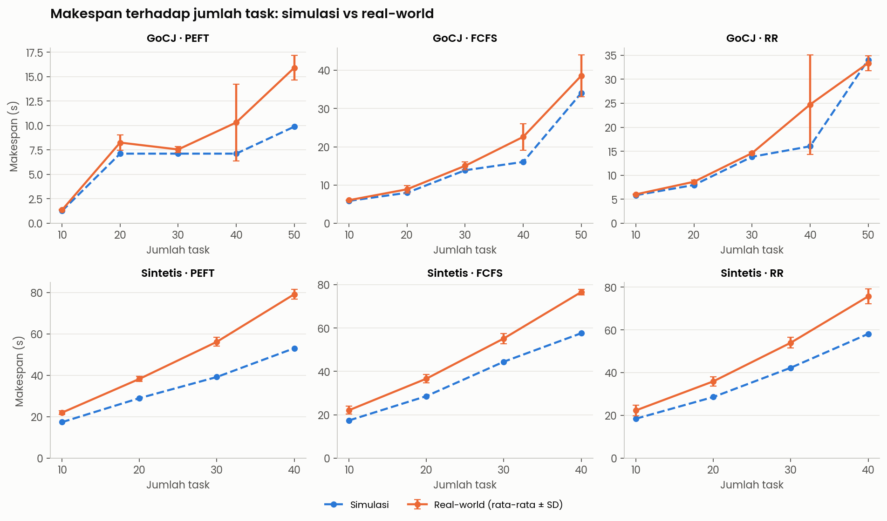</p>

Garis putus-putus biru = simulasi, garis utuh oranye = rata-rata 3 run nyata, dan garis tegak kecil = simpangan baku (semakin pendek, semakin konsisten).

| Task | PEFT sim | PEFT real | Selisih | FCFS sim | FCFS real | Selisih | RR sim | RR real | Selisih |
| ---: | ---: | ---: | ---: | ---: | ---: | ---: | ---: | ---: | ---: |
| 10 | 1,27 | 1,37 | +7,87% | 5,86 | 6,04 | +3,15% | 5,86 | 6,03 | +2,97% |
| 20 | 7,12 | 8,26 | +15,89% | 7,98 | 8,89 | +11,42% | 7,98 | 8,66 | +8,48% |
| 30 | 7,12 | 7,55 | +5,99% | 13,86 | 15,02 | +8,39% | 13,86 | 14,63 | +5,53% |
| 40 | 7,12 | 10,31 | +44,74% | 16,04 | 22,58 | +40,79% | 16,04 | 24,74 | +54,25% |
| 50 | 9,88 | 15,91 | +60,96% | 34,04 | 38,55 | +13,25% | 34,04 | 33,38 | -1,95% |

| Task | PEFT sim | PEFT real | Selisih | FCFS sim | FCFS real | Selisih | RR sim | RR real | Selisih |
| ---: | ---: | ---: | ---: | ---: | ---: | ---: | ---: | ---: | ---: |
| 10 | 17,40 | 22,01 | +26,46% | 17,40 | 22,13 | +27,16% | 18,47 | 22,35 | +21,05% |
| 20 | 29,00 | 38,31 | +32,11% | 28,61 | 36,68 | +28,17% | 28,61 | 35,93 | +25,61% |
| 30 | 39,22 | 56,23 | +43,35% | 44,49 | 55,21 | +24,10% | 42,29 | 54,00 | +27,67% |
| 40 | 53,11 | 79,21 | +49,14% | 57,62 | 76,61 | +32,96% | 58,13 | 75,66 | +30,16% |

**Apa yang terlihat.**
- **GoCJ**: garis nyata berimpit dengan simulasi di 10 – 30 task (selisih 3 – 16%). Pada 40 task, ketiga algoritma tiba-tiba menyimpang 41 – 54% dengan simpangan baku besar. Pada 50 task, PEFT menyimpang 61%, FCFS 13%, dan RR hampir tepat (-2%).
- **Sintetis**: garis nyata **selalu** di atas simulasi, bahkan sejak 10 task (21 – 27%). Selisih PEFT terus membesar (26% → 49%), sedangkan FCFS/RR tetap di kisaran 21 – 33%.

**Mengapa terjadi.**
- **Sintetis selalu membebani host-2.** Semua task 4 core hanya dapat dikerjakan vm-4 (di host-2), sehingga host-2 sudah sibuk sejak skala terkecil. Kontensi CPU di host-2 (Bagian 8.2) langsung membuat makespan membengkak.
- **PEFT menambah beban host-2 lebih banyak lagi.** Total kerja PEFT di host-2 adalah 268 detik-CPU pada 30 task dan 375 detik-CPU pada 40 task, lebih besar daripada FCFS/RR (224 dan 307 – 315 detik-CPU). Semakin padat host-2, semakin lambat VM-nya, semakin jauh PEFT dari prediksi simulasi.
- **GoCJ ringan di skala kecil.** Pada 10 – 30 task, kerja di host-2 hanya 3 – 36 detik-CPU, sehingga host-2 belum jenuh dan hasil nyata dekat dengan simulasi.
- **Lonjakan di 40 – 50 task GoCJ** terjadi karena job yang lebih banyak dan lebih besar mulai memenuhi host-2. Simpangan baku besar pada 40 task (RR: ± 10,37 detik) berasal dari satu run yang masih terganggu di tengah jalan: pemeriksaan kecepatan hanya mengecek sebelum dan sesudah run, bukan selama run (Bagian 12).
- **RR pada GoCJ 50 task hampir tepat** karena RR menaruh paling sedikit kerja di host-2 (39,7 detik-CPU), sehingga VM yang paling akhir selesai berada di host-1 yang tidak jenuh.

### 8.11 Seberapa jauh dunia nyata meleset dari simulasi?
<p align="center">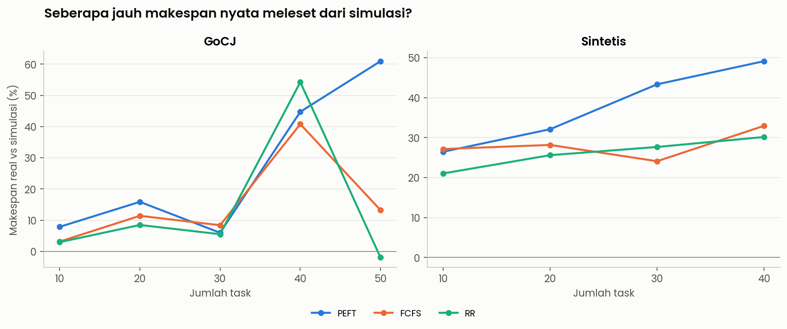</p>

**Apa yang terlihat.**
- Grafik ini meringkas kolom "Selisih" pada tabel 8.10. Semua titik di atas nol berarti dunia nyata lebih lambat dari simulasi.
- **Sintetis**: garis PEFT (biru) naik terus dan selalu paling tinggi mulai 20 task. FCFS dan RR relatif datar.
- **GoCJ**: semua algoritma rendah sampai 30 task, lalu melonjak bersama pada 40 task.

**Mengapa terjadi.**
- Garis PEFT sintetis yang naik terus adalah bukti paling jelas dari Bagian 8.2: **semakin banyak task yang PEFT tumpuk di host cepat, semakin besar prediksi PEFT meleset.**
- FCFS/RR membagi task bergiliran ke keempat VM, termasuk host-1 yang tidak pernah jenuh, sehingga selisihnya lebih stabil.

### 8.12 Bukti kontensi CPU di host
<p align="center">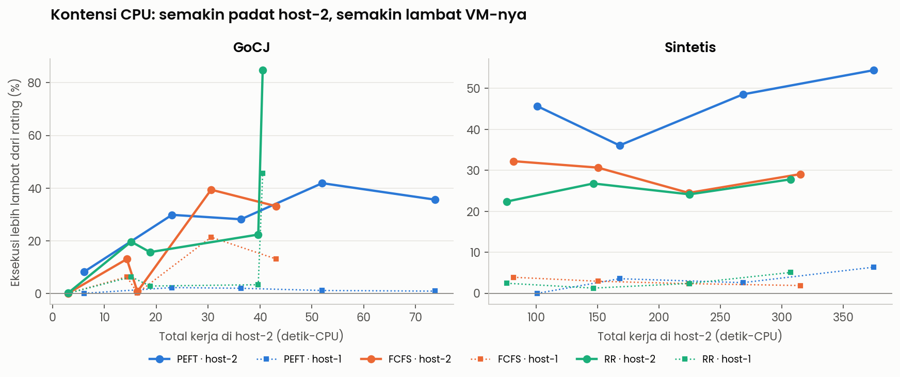</p>

Setiap titik adalah satu skala. Sumbu mendatar = total kerja di host-2, sumbu tegak = seberapa lambat VM bekerja dibanding spesifikasinya. Garis utuh bulat = VM di host-2, garis titik-titik kotak = VM di host-1.

| Task | Algoritma | Kerja host-2 (detik-CPU) | Inflasi eksekusi host-1 | Inflasi eksekusi host-2 | Overhead HTTP (ms) | Waiting sim FIFO ketat (s) |
| ---: | :--- | ---: | ---: | ---: | ---: | ---: |
| 10 | PEFT | 101,0 | 0,0% | 45,7% | 220 | 0,25 |
| 10 | FCFS | 81,5 | 3,9% | 32,2% | 198 | 0,33 |
| 10 | RR | 76,2 | 2,5% | 22,4% | 230 | 0,78 |
| 20 | PEFT | 167,9 | 3,6% | 36,1% | 314 | 2,02 |
| 20 | FCFS | 150,3 | 2,9% | 30,7% | 314 | 2,80 |
| 20 | RR | 146,6 | 1,3% | 26,8% | 310 | 2,56 |
| 30 | PEFT | 268,3 | 2,6% | 48,5% | 675 | 4,64 |
| 30 | FCFS | 224,2 | 2,4% | 24,5% | 773 | 7,73 |
| 30 | RR | 224,9 | 2,4% | 24,1% | 676 | 6,99 |
| 40 | PEFT | 374,8 | 6,4% | 54,4% | 994 | 7,81 |
| 40 | FCFS | 315,0 | 1,9% | 29,1% | 1.077 | 11,78 |
| 40 | RR | 307,1 | 5,1% | 27,8% | 1.093 | 12,24 |

**Apa yang terlihat.**
- **Garis host-1 (titik-titik) hampir selalu di dekat nol** (0 – 6%): VM di host-1 bekerja sesuai spesifikasi.
- **Garis host-2 (utuh) selalu jauh di atas**: 22 – 54% lebih lambat pada data sintetis, dan 0 – 42% pada GoCJ (naik seiring beban).
- Pada data sintetis, **garis PEFT selalu paling tinggi** (36 – 54%) dan berada paling kanan (kerja di host-2 paling banyak).
- Terdapat satu titik GoCJ yang menyimpang: RR pada 40 task, host-1 +46% dan host-2 +85%. Itu adalah run yang terganggu di tengah jalan (lihat 8.10).

**Mengapa terjadi.**
- host-1 (1 CPU) hanya menampung VM 1.000 MIPS yang membutuhkan sedikit CPU, sehingga selalu memiliki kapasitas tersisa. host-2 (2 CPU) menampung 6 core 2.000 MIPS yang bersama-sama membutuhkan hampir seluruh CPU-nya. Begitu semua core sibuk, mereka bersaing memakai CPU dan semuanya melambat.
- Simulasi menganggap setiap VM memiliki CPU sendiri, sehingga perlambatan 22 – 54% ini **sama sekali tidak terlihat** di simulasi. Inilah sumber terbesar perbedaan simulasi vs dunia nyata, dan polanya konsisten di semua skala.
- Kolom "Overhead HTTP" juga naik dari ~0,2 detik (10 task) ke ~1 detik (40 task) per task, karena server HTTP di worker ikut bersaing memakai CPU di host yang sibuk.

### 8.13 Waktu antre dan turnaround di setiap skala
<p align="center">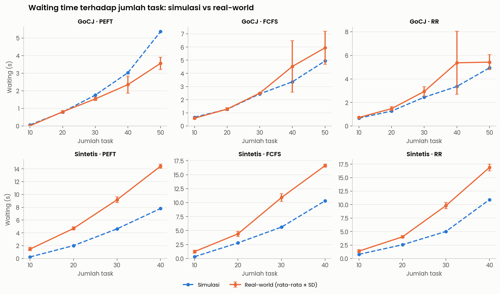</p>

| Task | PEFT sim | PEFT real | Selisih | FCFS sim | FCFS real | Selisih | RR sim | RR real | Selisih |
| ---: | ---: | ---: | ---: | ---: | ---: | ---: | ---: | ---: | ---: |
| 10 | 0,07 | 0,01 | -77,49% | 0,67 | 0,59 | -11,69% | 0,67 | 0,73 | +9,17% |
| 20 | 0,79 | 0,81 | +2,04% | 1,27 | 1,29 | +1,26% | 1,27 | 1,47 | +15,91% |
| 30 | 1,76 | 1,54 | -12,37% | 2,44 | 2,50 | +2,26% | 2,44 | 2,94 | +20,21% |
| 40 | 3,03 | 2,35 | -22,41% | 3,36 | 4,53 | +34,85% | 3,36 | 5,37 | +59,87% |
| 50 | 5,36 | 3,56 | -33,61% | 4,94 | 5,94 | +20,32% | 4,94 | 5,43 | +9,83% |

| Task | PEFT sim | PEFT real | Selisih | FCFS sim | FCFS real | Selisih | RR sim | RR real | Selisih |
| ---: | ---: | ---: | ---: | ---: | ---: | ---: | ---: | ---: | ---: |
| 10 | 0,25 | 1,47 | +497,19% | 0,33 | 1,24 | +277,80% | 0,78 | 1,38 | +76,34% |
| 20 | 2,02 | 4,70 | +132,60% | 2,80 | 4,42 | +57,85% | 2,56 | 4,02 | +57,34% |
| 30 | 4,64 | 9,18 | +97,95% | 5,63 | 10,92 | +93,94% | 5,02 | 9,82 | +95,46% |
| 40 | 7,81 | 14,41 | +84,53% | 10,32 | 16,61 | +61,04% | 10,92 | 16,89 | +54,65% |

**Apa yang terlihat.**
- **Sintetis**: waktu antre nyata **1,5 – 2 kali** simulasi di semua skala dan semua algoritma.
- **GoCJ FCFS/RR**: waktu antre nyata sama atau lebih besar dari simulasi.
- **GoCJ PEFT justru kebalikannya**: pada 30 – 50 task, waktu antre nyata **lebih kecil** dari simulasi (12 – 34% lebih singkat).

**Mengapa terjadi.**
- **Sintetis**: keterlambatan berakumulasi di antrean (Bagian 8.4). Setiap task di host-2 sedikit lebih lambat, sehingga semua task di belakangnya ikut menunggu lebih lama. Untuk FCFS/RR ditambah masalah FIFO ketat (Bagian 8.3): kolom "Waiting sim FIFO ketat" di tabel 8.12 menunjukkan aturan antrean saja sudah menaikkan waktu antre FCFS dari 10,32 menjadi 11,78 detik pada 40 task.
- **GoCJ PEFT lebih cepat dari simulasi** karena ***race condition* urutan kedatangan** (Bagian 8.5). Di simulasi, PEFT mengantrekan task **terbesar dulu**, sehingga task kecil harus menunggu task besar. Di dunia nyata, semua task dikirim bersamaan dan urutan tibanya acak, sehingga sebagian task kecil tiba lebih dahulu. Rata-rata waktu antre pun turun, serupa dengan efek penjadwalan *shortest job first*.

Turnaround (antre + dikerjakan + jeda jaringan) mengikuti pola yang sama dengan waktu antre:

<p align="center">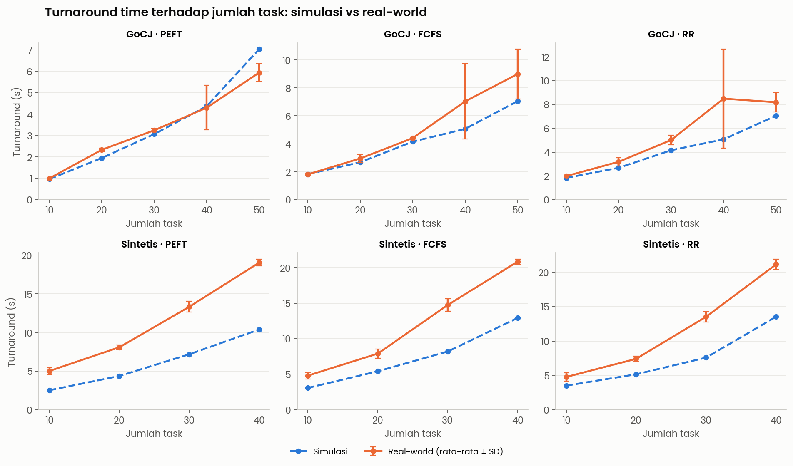</p>

### 8.14 Energi di setiap skala
<p align="center">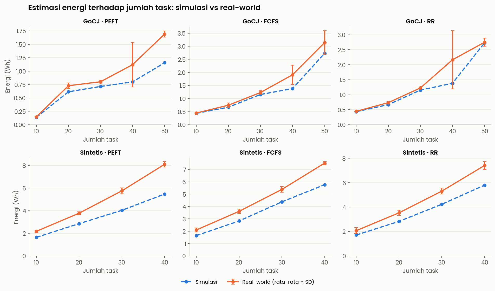</p>

| Task | PEFT sim | PEFT real | Selisih | FCFS sim | FCFS real | Selisih | RR sim | RR real | Selisih |
| ---: | ---: | ---: | ---: | ---: | ---: | ---: | ---: | ---: | ---: |
| 10 | 1,643 | 2,177 | +32,52% | 1,645 | 2,101 | +27,76% | 1,714 | 2,072 | +20,93% |
| 20 | 2,854 | 3,779 | +32,41% | 2,831 | 3,611 | +27,55% | 2,831 | 3,533 | +24,81% |
| 30 | 4,034 | 5,757 | +42,71% | 4,377 | 5,384 | +23,00% | 4,234 | 5,311 | +25,42% |
| 40 | 5,474 | 8,105 | +48,08% | 5,767 | 7,516 | +30,33% | 5,801 | 7,413 | +27,79% |

**Apa yang terlihat.**
- Energi nyata selalu lebih besar dari simulasi. Pada sintetis 21 – 48%, pada GoCJ 1 – 57%.
- Pada sintetis, selisih PEFT paling besar dan terus naik (33% → 48%).

**Mengapa terjadi.**
- Energi dihitung dari lama host sibuk dan lama host menyala (Bagian 3.3). VM yang melambat membuat host-2 **lebih lama sibuk**, dan makespan yang lebih panjang membuat kedua host **lebih lama menyala**.
- Kerja PEFT paling banyak di host-2, yang memakai daya paling besar (300 W saat sibuk). Oleh karena itu, waktu tambahan akibat kontensi CPU terjadi pada host dengan konsumsi daya tertinggi.

### 8.15 Apakah keunggulan PEFT bertahan di setiap skala?
<p align="center">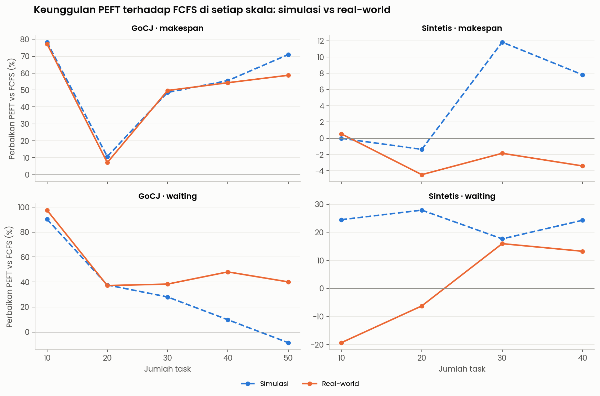</p>

Angka = seberapa jauh PEFT lebih baik daripada FCFS (positif = PEFT lebih baik, negatif = PEFT lebih buruk).

| Task | Makespan sim | Makespan real | Waiting sim | Waiting real | Energi sim | Energi real |
| ---: | ---: | ---: | ---: | ---: | ---: | ---: |
| 10 | 78,3% | 77,3% | 90,3% | 97,5% | 68,5% | 67,1% |
| 20 | 10,7% | 7,1% | 37,6% | 37,1% | 8,4% | 2,5% |
| 30 | 48,6% | 49,7% | 28,0% | 38,3% | 38,1% | 34,9% |
| 40 | 55,6% | 54,3% | 9,8% | 48,1% | 42,1% | 41,3% |
| 50 | 71,0% | 58,7% | -8,6% | 40,1% | 57,6% | 46,1% |

| Task | Makespan sim | Makespan real | Waiting sim | Waiting real | Energi sim | Energi real |
| ---: | ---: | ---: | ---: | ---: | ---: | ---: |
| 10 | 0,0% | 0,5% | 24,5% | -19,4% | 0,1% | -3,6% |
| 20 | -1,4% | -4,5% | 27,9% | -6,3% | -0,8% | -4,7% |
| 30 | 11,8% | -1,8% | 17,6% | 15,9% | 7,8% | -6,9% |
| 40 | 7,8% | -3,4% | 24,3% | 13,2% | 5,1% | -7,8% |

**Apa yang terlihat.**
- **GoCJ makespan**: garis nyata hampir menimpa garis simulasi di semua skala. PEFT unggul 50 – 59% pada 30 – 50 task.
- **GoCJ waktu antre**: keunggulan PEFT di dunia nyata **lebih besar** daripada simulasi pada 30 – 50 task (38 – 48% vs -9 – 28%).
- **Sintetis makespan**: simulasi memprediksi PEFT unggul 8 – 12% pada 30 – 40 task, tetapi di dunia nyata PEFT kalah tipis (-2 sampai -3%).
- **Sintetis waktu antre**: PEFT kalah pada 10 – 20 task (-19% dan -6%), tetapi unggul pada 30 – 40 task (16% dan 13%).
- **Penurunan tajam di GoCJ 20 task** muncul di simulasi **dan** dunia nyata.

**Mengapa terjadi.**
- **GoCJ**: keunggulan PEFT datang dari menaruh job berukuran sangat besar di VM cepat, sementara FCFS/RR kadang menaruhnya di VM lambat. Efek ini besar dan tidak hilang walaupun ada kontensi CPU. Waktu antre PEFT bahkan terbantu oleh *race condition* urutan kedatangan (8.13), sedangkan FCFS/RR dirugikan FIFO ketat.
- **GoCJ 20 task**: urutan pembagian FCFS menempatkan job terbesar (14.250 MI, task nomor 11) di vm-4 yang cepat, sehingga FCFS hampir sama baiknya dengan PEFT. Pada 30 task, FCFS menaruh job besar lain (10.500 MI, task 21) di vm-2 yang lambat, dan selisihnya kembali besar. Hasil FCFS/RR bergantung pada **urutan task**, bukan pada perhitungan.
- **Sintetis**: PEFT menumpuk task di host-2, lalu terdampak kontensi CPU paling besar (8.12). Prediksi EFT-nya terlalu optimis karena kecepatan VM diukur saat host kosong, sehingga keunggulan makespan-nya habis. Pada 10 – 20 task, PEFT menaruh task kecil di VM cepat host-2 yang ternyata melambat, sehingga task kecil itu justru menunggu lebih lama daripada di host-1 (pilihan FCFS). Pada 30 – 40 task, antrean vm-4 sangat panjang untuk semua algoritma, dan aturan FIFO ketat lebih merugikan FCFS/RR, sehingga PEFT kembali unggul di waktu antre.

### 8.16 Ringkasan: apakah eksperimen berskala menguatkan percobaan pertama?

| Temuan percobaan pertama (30 task, 1 run) | Eksperimen berskala (10 – 50 task, 3 run) | Kesimpulan |
| :--- | :--- | :--- |
| PEFT unggul jauh di GoCJ (makespan -44,99%) | Unggul 7 – 77%, dan 50 – 59% pada 30 – 50 task | **Terbukti** di semua skala |
| Keunggulan PEFT di sintetis kecil (3,55%) | Hilang: PEFT -2 sampai -5% pada 20 – 40 task | **Lebih kuat**: keunggulannya bukan hanya kecil, tetapi hilang |
| VM host-1 sesuai spesifikasi, VM host-2 melambat | host-1 0 – 6%, host-2 22 – 54% (sintetis) | **Terbukti** di semua skala |
| PEFT paling jauh dari prediksi simulasi | Selisih PEFT sintetis naik 26% → 49%, selalu paling besar | **Terbukti**, dan makin parah seiring skala |
| Simulasi akurat jika host tidak sibuk | GoCJ 10 – 30 task: selisih 3 – 16% | **Terbukti** |
| *Race condition* urutan kedatangan membuat waktu selesai per task acak | Waktu antre GoCJ PEFT nyata 12 – 34% lebih kecil dari simulasi | **Temuan baru**: efeknya bisa menguntungkan |

---

## 9. Gangguan Eksternal: Beban Lain, Mode Daya, dan Memori Laptop

Saat eksperimen berskala dijalankan pertama kali, hasilnya menyimpang jauh: sintetis 30 task membutuhkan 82 detik, padahal percobaan pertama hanya 48 detik. Penyebabnya **bukan algoritma**, melainkan kondisi laptop yang menjalankan seluruh datacenter.

**Buktinya ada di langkah kalibrasi.** Sebelum setiap run, broker mengukur kecepatan setiap VM **sendirian** (Bagian 4.2). Jika laptop tenang, hasilnya selalu sekitar 1.000 / 1.000 / 2.000 / 2.000 MIPS. Pada run yang terganggu, hasilnya jauh di bawah itu. Contoh output terminal dari GoCJ 50 task run 1 ([`hasil/batch_terganggu/gocj_50_run1_batch1/log.txt`](hasil/batch_terganggu/gocj_50_run1_batch1/log.txt)):

<p align="center">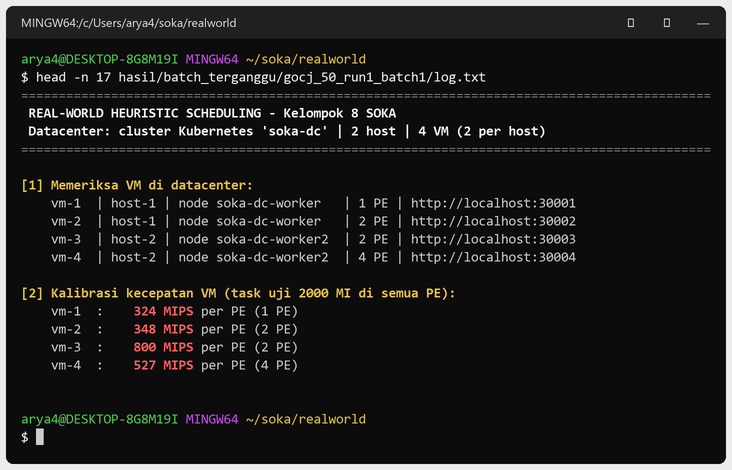</p>

<details><summary>Teks output (dapat disalin)</summary>

```text
arya4@DESKTOP-8G8M19I MINGW64 ~/soka/realworld
$ head -n 17 hasil/batch_terganggu/gocj_50_run1_batch1/log.txt
============================================================================================
 REAL-WORLD HEURISTIC SCHEDULING - Kelompok 8 SOKA
 Datacenter: cluster Kubernetes 'soka-dc' | 2 host | 4 VM (2 per host)
============================================================================================

[1] Memeriksa VM di datacenter:
    vm-1  | host-1 | node soka-dc-worker   | 1 PE | http://localhost:30001
    vm-2  | host-1 | node soka-dc-worker   | 2 PE | http://localhost:30002
    vm-3  | host-2 | node soka-dc-worker2  | 2 PE | http://localhost:30003
    vm-4  | host-2 | node soka-dc-worker2  | 4 PE | http://localhost:30004

[2] Kalibrasi kecepatan VM (task uji 2000 MI di semua PE):
    vm-1  :    324 MIPS per PE (1 PE)
    vm-2  :    348 MIPS per PE (2 PE)
    vm-3  :    800 MIPS per PE (2 PE)
    vm-4  :    527 MIPS per PE (4 PE)
```

</details>

Seluruh VM hanya bekerja di 26 – 40% kecepatannya, sebelum satu task pun dikirim.

| Run yang dibuang | Kecepatan saat kalibrasi (vm-1 / vm-2 / vm-3 / vm-4, MIPS) | Makespan PEFT run terganggu | Makespan PEFT run bersih | Penyebab yang paling mungkin |
| :--- | :--- | ---: | ---: | :--- |
| GoCJ 50 task, run 1 | 324 / 348 / 800 / 527 | 28,42 s | 15,91 s (**+79%**) | Program lain di laptop |
| Sintetis 30 task, run 2 | 642 / 623 / 1.497 / 1.079 | 90,98 s | 56,23 s (**+62%**) | Program lain di laptop |
| Sintetis 40 task, run 1 – 3 | 640 – 714 / 520 – 621 / 1.227 – 1.532 / 1.079 – 1.202 | 124,66 – 128,36 s | 79,21 s (**+57 – 62%**) | Program lain di laptop |
| Sintetis 50 task, run 2 | 399 / 343 / 621 / 480 | 206,61 s | — | Uji tampilan website (headless Chrome) |
| Sintetis 50 task, percobaan 1 – 5 | 604 – 765 / 570 – 664 / 1.296 – 1.997 / 1.010 – 1.687 | 145,65 – 172,26 s | — | Laptop memakai **baterai** |
| Sintetis 50 task, run terakhir | 1.000 / 991 / 1.998 / 1.997 | — (dihentikan) | — | **Memori** laptop hampir habis |

Semua run yang dibuang disimpan utuh di [`hasil/batch_terganggu/`](hasil/batch_terganggu) beserta log terminalnya.

**Apa yang terlihat.**
- Pada run terganggu, makespan PEFT **57 – 79% lebih lama** daripada run bersih dengan dataset dan algoritma yang sama persis.
- Gangguan datang dari tiga sumber berbeda: program lain, mode baterai, dan memori.

**Mengapa terjadi.**
- **Program lain di laptop.** Semua host dan VM sebenarnya berbagi satu CPU fisik dengan aplikasi lain: browser (terutama halaman 3D yang berat), Discord, IDE, dan uji tampilan website. Saat aplikasi itu sibuk, VM kebagian CPU lebih sedikit.
- **Mode baterai.** Saat laptop tidak dicolok charger, Windows mode *Balanced* menurunkan kecepatan prosesor untuk menghemat baterai. Saat pengecekan, Windows melaporkan baterai 60% dengan status 1 (*discharging*, tidak dicolok charger).
  vm-1 yang paling dibatasi jatah CPU-nya (0,2 CPU) langsung turun ke ~660 MIPS. Kubernetes mencatat vm-1 sudah belasan ribu kali dibatasi (*throttled*) karena mencapai batas jatahnya (`nr_throttled` pada screenshot di bawah).
- **Memori hampir habis.** Docker, WSL, browser, dan aplikasi lain memakai hampir seluruh 13,6 GB RAM (tersisa ~2 GB), sehingga Claude Code menghentikan proses eksperimen untuk mencegah sistem berhenti merespons.

Output terminal di bawah menunjukkan dua hal: (1) baris log saat laptop memakai baterai, ketika pemeriksaan kecepatan terus menunggu karena vm-1 tidak mencapai 95% kecepatannya; (2) penghitung throttling vm-1 (jumlah total sejak VM menyala): `cpu.max 20000 100000` berarti vm-1 hanya boleh memakai 0,2 CPU, dan `nr_throttled` adalah berapa kali vm-1 dibatasi (*throttled*) karena mencapai batas tersebut.

<p align="center">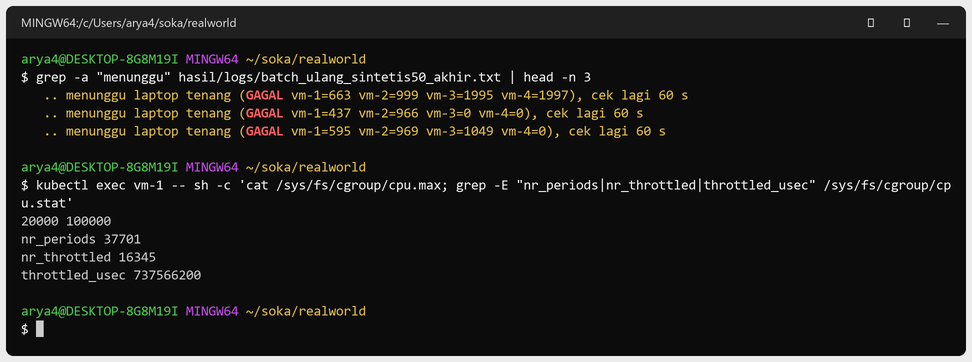</p>

<details><summary>Teks output (dapat disalin)</summary>

```text
arya4@DESKTOP-8G8M19I MINGW64 ~/soka/realworld
$ grep -a "menunggu" hasil/logs/batch_ulang_sintetis50_akhir.txt | head -n 3
   .. menunggu laptop tenang (GAGAL vm-1=663 vm-2=999 vm-3=1995 vm-4=1997), cek lagi 60 s
   .. menunggu laptop tenang (GAGAL vm-1=437 vm-2=966 vm-3=0 vm-4=0), cek lagi 60 s
   .. menunggu laptop tenang (GAGAL vm-1=595 vm-2=969 vm-3=1049 vm-4=0), cek lagi 60 s
arya4@DESKTOP-8G8M19I MINGW64 ~/soka/realworld
$ kubectl exec vm-1 -- sh -c 'cat /sys/fs/cgroup/cpu.max; grep -E "nr_periods|nr_throttled|throttled_usec" /sys/fs/cgroup/cpu.stat'
20000 100000
nr_periods 37701
nr_throttled 16345
throttled_usec 737566200
```

</details>

**Kaitannya dengan cloud nyata.** Di cloud publik, VM juga berbagi mesin fisik dengan VM pelanggan lain (*noisy neighbor*), dan penyedia cloud dapat menurunkan kecepatan prosesor untuk menghemat daya atau mengatasi panas. CloudSim **tidak memodelkan** satu pun dari hal ini: di simulasi, VM 1.000 MIPS selalu tepat 1.000 MIPS. Karena itu, eksperimen nyata harus dijaga dengan pengecekan seperti di Bagian 7.1, dan hasilnya harus dirata-rata dari beberapa run.

---

## 10. Kaitan dengan Simulasi CloudSim Skala Besar

Di README induk, keunggulan PEFT di GoCJ mencapai 80%, sedangkan di sini hanya 45%. Apakah itu karena dunia nyata? Tabel di bawah memisahkan dua penyebab: **ukuran percobaan yang berbeda** dan **efek dunia nyata**.

| Keunggulan makespan PEFT vs FCFS | CloudSim 1.000 task (`3dc` / `2dc`) | CloudSim 100 task (`3dc` / `2dc`) | Kembaran simulasi 30 task, 4 VM (percobaan pertama / rata-rata 3 run) | Dunia nyata 30 task, 4 VM (percobaan pertama / rata-rata 3 run) |
| :--- | ---: | ---: | ---: | ---: |
| GoCJ | 80,87% / 79,21% | 45,55% / 49,99% | 48,59% / 48,6% | 44,99% / 49,7% |
| Sintetis | 15,39% / 29,78% | 12,82% / 6,02% | 13,62% / 11,8% | 3,55% / -1,8% |

Bandingkan kolom yang bersebelahan: penurunan dari kolom 1 ke kolom 3 disebabkan **ukuran percobaan**; penurunan dari kolom 3 ke kolom 4 disebabkan **dunia nyata**.

- **GoCJ**: penurunan besar 80% → 49% sudah terjadi **di dalam simulasi**, hanya karena jumlah job dan VM lebih sedikit. Dengan 1.000 job, FCFS/RR menumpuk puluhan job besar di VM lambat; dengan 30 job, kerugiannya terbatas. Perpindahan ke dunia nyata hanya mengurangi 3,6 poin pada percobaan pertama, dan pada rata-rata 3 run justru tidak mengurangi sama sekali (48,6% → 49,7%). Hasil kembaran 30 task (48,59%) juga mirip dengan CloudSim 100 job (45,55 – 49,99%). Pada keduanya, makespan PEFT ditentukan oleh **satu job terbesar** (450,21 detik di CloudSim; 7,13 detik di sini = 14.250 MI ÷ 2.000 MIPS). Itu batas tercepat yang mungkin dicapai algoritma apa pun.
- **Sintetis**: kembaran 30 task (13,62%) masih dalam rentang CloudSim (6 – 30%), sehingga ukuran percobaan bukan masalahnya. Penurunan terbesar (13,62% → 3,55% pada percobaan pertama, dan 11,8% → -1,8% pada rata-rata 3 run) justru terjadi **saat pindah ke dunia nyata**, dan Bagian 8.2 menjelaskan sebabnya.

**Kesimpulannya:** CloudSim **tepat dalam menentukan peringkat algoritma**, tetapi **menaksir terlalu tinggi besarnya keunggulan PEFT** ketika beban kerja membuat host cepat jenuh.

---

## 11. Kesimpulan

1. **PEFT berhasil dijalankan di cloud nyata** (Kubernetes, 1 datacenter, 2 host, 4 VM) dengan rumus yang sama dengan simulasi, memakai kecepatan VM hasil pengukuran langsung. Seluruh hasil didukung 27 run bersih (3 run per skala) ditambah percobaan pertama yang dianalisis per task.
2. **Pada GoCJ, PEFT adalah algoritma terbaik di dunia nyata, di semua skala.** Makespan 7 – 77% lebih cepat dan waktu antre 37 – 97% lebih singkat daripada FCFS. Keunggulan ini dekat dengan prediksi simulasi.
3. **Pada data sintetis, keunggulan makespan PEFT yang diprediksi simulasi (8 – 12%) hilang di dunia nyata** (-2 sampai -5%). PEFT hanya masih unggul di waktu antre pada 30 – 40 task (13 – 16%).
4. **Simulasi akurat jika syaratnya terpenuhi.** Jika host tidak jenuh (GoCJ 10 – 30 task), selisih makespan simulasi vs nyata hanya 3 – 16%, bahkan 0,07 – 0,20% pada percobaan pertama GoCJ FCFS/RR.
5. **Simulasi terlalu optimis jika syaratnya dilanggar.** Anggapan CloudSim yang paling lemah adalah **"setiap VM memiliki CPU sendiri dan tidak terganggu VM lain"**. Pada data sintetis, VM di host-2 bekerja 22 – 54% lebih lambat dari spesifikasinya, sehingga makespan nyata 21 – 49% lebih lama dari simulasi.
6. **Algoritma yang selalu memilih VM tercepat paling dirugikan oleh kontensi CPU.** Selisih simulasi vs nyata PEFT paling besar dan semakin besar seiring jumlah task (26% → 49% pada sintetis).
7. **Dunia nyata juga dipengaruhi hal di luar cloud itu sendiri.** Program lain, mode baterai, dan memori laptop membuat 16 dari 30 run pertama harus dibuang (VM hanya 324 – 970 MIPS, makespan 57 – 79% lebih lama). Eksperimen cloud nyata harus dijaga dengan pengecekan kondisi mesin dan diulang beberapa kali.
8. **Saran perbaikan PEFT untuk dunia nyata:**
   - Ukur kecepatan VM **saat VM lain juga sedang sibuk**, atau perbarui terus dari waktu kerja task yang sudah selesai, supaya prediksinya mengikuti kondisi nyata.
   - Tambahkan **penalti untuk host yang sudah padat**, misalnya kecepatan VM dianggap lebih lambat saat host-nya sudah padat: $\text{EET} = \frac{\text{ukuran}}{\text{MIPS} \times f_{\text{host}}}$ dengan $f_{\text{host}} < 1$.
   - Terapkan ***backfilling*** pada antrean worker agar perilakunya sama dengan CloudSim.

---

## 12. Keterbatasan

- **Sintetis 50 task tidak berhasil diukur.** Semua percobaannya terganggu (baterai, memori, atau program lain) dan dibuang, sehingga data sintetis hanya sampai 40 task.
- **Pemeriksaan kecepatan hanya mengecek sebelum dan sesudah run**, dengan task uji 1 core per VM. Gangguan singkat di tengah run atau perlambatan ringan saat semua core sibuk tetap dapat lolos (contoh: GoCJ RR 40 task, ± 10,37 detik). Ini juga menjelaskan mengapa hasil antar-sesi berbeda (sintetis 30 task PEFT: 47,84 detik pada percobaan pertama vs 56,23 ± 2,16 detik pada eksperimen berskala).
- 3 run per skala masih sedikit. Simpangan baku sudah dilaporkan, tetapi belum ada uji statistik.
- Seluruh "datacenter" berjalan di **satu laptop**. Kedua host sebenarnya berbagi CPU fisik yang sama, sehingga kontensi CPU dapat lebih besar (atau berbeda pola) dibanding server fisik yang benar-benar terpisah.
- Ukuran task diperkecil (GoCJ ÷ 50, sintetis juga dikecilkan) agar percobaan cepat. Akibatnya jeda jaringan yang tetap (0,1 – 1 detik) terasa lebih besar dibanding pada task berukuran asli.
- Energi adalah **perkiraan** dari model SPECpower berdasarkan lama sibuk nyata, bukan hasil pengukuran listrik.
- Kembaran simulasi meniru aturan CloudSim Plus (VM berkecepatan tetap, antrean dengan *backfilling*), tetapi bukan CloudSim Plus itu sendiri yang dijalankan pada infrastruktur 4 VM.

---

## 13. Menjalankan Eksperimen

Prasyarat: Docker Desktop menyala (*Engine running*), `kind`, `kubectl`, Java 21, dan Python 3 dengan `matplotlib` (untuk analisis). Jalankan dari Git Bash di folder `realworld/`:

```bash
bash setup.sh                                      # bangun datacenter + 4 VM (aman diulang)
kubectl get nodes -L host,tier                     # tunjukkan 2 host
kubectl get pods -o wide                           # tunjukkan 2 VM per host

java broker/RealWorldBroker.java ALL gocj 30       # ~1 menit: PEFT vs FCFS vs RR, dataset GoCJ
java broker/RealWorldBroker.java ALL synthetic 30  # ~3 menit: dataset sintetis 1/2/4 PE

python analisis/bandingkan_simulasi.py             # kembaran simulasi + grafik perbandingan
```

Untuk eksperimen berskala (10 – 50 task × 3 run, sekitar 1 – 1,5 jam). Pastikan laptop **dicolok charger** dan aplikasi berat ditutup:

```bash
bash batch.sh                                      # semua skala; run yang sudah ada dilewati
SCALES="30 40" RUNS=3 bash batch.sh                # hanya skala tertentu
python analisis/bandingkan_simulasi.py             # analisis ulang + grafik + hasil/batch_tabel.md
```

Argumen broker: `[ALL|PEFT|FCFS|RR] [synthetic|gocj] [jumlah task] [folder hasil]`. Hasil per task dan ringkasan disimpan di `hasil/`; skrip analisis membaca berkas tersebut lalu menulis CSV perbandingan ke `hasil/` dan grafik ke `grafik/`.

Perintah lain yang berguna:

```bash
kubectl logs vm-4                  # log VM
kubectl top pod                    # (memerlukan metrics-server) pemakaian CPU per VM
kind delete cluster --name soka-dc # hapus datacenter
```

---

## 14. Struktur Folder

```
realworld/
├── setup.sh                         # Bangun cluster kind, batasi CPU host, jalankan 4 VM
├── batch.sh                         # Eksperimen berskala 10-50 task x 3 run + pemeriksaan kecepatan
├── k8s/
│   ├── kind-cluster.yaml            # Datacenter: 1 control-plane + 2 worker node (host)
│   └── vms.yaml                     # 4 pod VM (2 per host) + Service NodePort 30001-30004
├── worker/
│   └── worker.py                    # Worker VM: antrean PE + beban CPU nyata ber-MIPS tetap
├── broker/
│   └── RealWorldBroker.java         # Kalibrasi, PEFT/FCFS/RR, eksekusi nyata, metrik
├── analisis/
│   └── bandingkan_simulasi.py       # Kembaran simulasi, dekomposisi overhead, grafik, tabel
├── hasil/
│   ├── log_{gocj,synthetic}_ALL.txt # Output terminal percobaan pertama (30 task)
│   ├── ringkasan_{dataset}.csv      # Metrik real percobaan pertama
│   ├── task_{dataset}_{algo}.csv    # Data per task percobaan pertama
│   ├── perbandingan_sim_vs_real.csv # Percobaan pertama: simulasi vs FIFO ketat vs real
│   ├── dekomposisi_overhead.csv     # Percobaan pertama: dispatch, HTTP, inflasi eksekusi
│   ├── batch/{dataset}_{n}/run{r}/  # 27 run bersih: log.txt, ringkasan, data per task
│   ├── batch_terganggu/             # Run yang dibuang pemeriksaan kecepatan (bukti Bagian 9)
│   ├── batch_sim_vs_real.csv        # Eksperimen berskala: simulasi vs real per skala
│   ├── batch_host_inflasi.csv       # Eksperimen berskala: perlambatan host & overhead
│   ├── batch_tabel.md               # Tabel siap tempel untuk README
│   └── logs/                        # setup.txt, infrastruktur.txt, log batch & pengecekan
└── grafik/                          # 16 grafik perbandingan (Bagian 8)
```

---

## 15. Referensi

1. Arabnejad H, Barbosa JG. List Scheduling Algorithm for Heterogeneous Systems by an Optimistic Cost Table. *IEEE Transactions on Parallel and Distributed Systems*. 2014;25(3):682–694.
2. Beloglazov A, Buyya R. Optimal online deterministic algorithms and adaptive heuristics for energy and performance efficient dynamic consolidation of virtual machines in cloud data centers. *Concurrency and Computation: Practice and Experience*. 2012;24(13):1397–1420.
3. Silva Filho MC, Oliveira RL, Monteiro CC, Inácio PRM, Freire MM. CloudSim Plus: A cloud computing simulation framework pursuing software engineering principles for improved modularity, extensibility and correctness. *IFIP/IEEE International Symposium on Integrated Network Management (IM)*. 2017.
4. Hussain A, Aleem M. GoCJ: Google Cloud Jobs Dataset for Distributed and Cloud Computing Infrastructures. *Data*. 2018;3(4):38.
5. Burns B, Grant B, Oppenheimer D, Brewer E, Wilkes J. Borg, Omega, and Kubernetes. *Communications of the ACM*. 2016;59(5):50–57.
6. Koh Y, Knauerhase R, Brett P, Bowman M, Wen Z, Pu C. An Analysis of Performance Interference Effects in Virtual Environments. *IEEE International Symposium on Performance Analysis of Systems & Software (ISPASS)*. 2007:200–209.

---
<p align="center">
  <b>Kelompok 8 · Strategi Optimasi Komputasi Awan (SOKA)</b><br>
  Departemen Teknologi Informasi, Institut Teknologi Sepuluh Nopember · Surabaya, 2026
</p>
